# Back-office — quản trị hệ thống và quản lý lớp học

Ứng dụng web cho **Quản trị hệ thống** (Q) và **Quản lý lớp học** (L): `…/admin/`. Quản lý lớp học làm mọi việc vận hành (lễ tân, kế toán, điểm danh, học viên, bán khóa học, sắp xếp giáo viên, danh mục, đảo ngược chứng từ); chỉ **thiết đặt hệ thống** (cấu hình chung, tài khoản quản trị) là của Quản trị hệ thống. Ảnh chụp ngày 10/10/2026 trên dữ liệu mẫu, màn 1440×900. Số buổi, ngày giờ và mã chứng từ tự sinh sẽ khác trên dữ liệu thật.

| Mã | Case | Phút | Ai |
|---|---|---|---|
| [A1](#a1--tổng-quan) | Tổng quan: học viên, doanh thu, công nợ, sắp hết buổi | 2 | Q, L |
| [A2](#a2--học-viên) | Tìm học viên, hồ sơ và 5 tab | 4 | Q, L |
| [A3](#a3--bán-khóa-học) | Bán khóa học: giảm giá → thu tiền → ghi sổ | 6 | L |
| [A4](#a4--thu-nợ) | Thu tiền còn nợ | 3 | L |
| [A5](#a5--điểm-danh-ở-văn-phòng) | Điểm danh theo ca và theo từng học viên đến lớp; đăng ký trước (tùy chọn) | 6 | L |
| [A6](#a6--hủy-hoặc-chuyển-buổi-điểm-danh) | Hủy hoặc chuyển buổi điểm danh | 3 | L, Q |
| [A7](#a7--đảo-ngược-đơn-bán) | Đảo ngược đơn đã ghi sổ (hoàn cả tiền đã thu) | 3 | L, Q |
| [A8](#a8--nhập-họa-cụ) | Nhập họa cụ: tồn kho, giá vốn, chi quỹ | 4 | L |
| [A9](#a9--bảng-lương-giáo-viên) | Bảng lương: gợi ý từ số buổi dạy, khấu trừ | 5 | L, Q |
| [A10](#a10--sổ-cái-và-đối-soát) | Sổ quỹ, sổ cái và đối soát | 3 | L, Q |
| [A11](#a11--báo-cáo-hiệu-suất-và-lịch-học) | Báo cáo hiệu suất và lịch học dự kiến | 3 | Q |
| [A12](#a12--thiết-lập-và-mã-mời) | Học phí, cấu hình, mã mời giáo viên / phụ huynh | 4 | L, Q |
| [A13](#a13--phân-quyền) | Hai vai trò khác nhau ở đâu | 3 | Q, L |

Thứ tự trình bày gợi ý: A1 → A2 → A3 → A4 → A5 → A6 → A7 → A8 → A9 → A10 → A11 → A12 → A13.

---

### A1 · Tổng quan

| Ai | Ứng dụng | Thời lượng |
|---|---|---|
| Q hoặc L | Back-office | 2 phút |

**Mục tiêu:** nhìn một màn hình biết trung tâm đang thế nào hôm nay.

1. Mở `…/admin/` (mục **Tổng quan**).

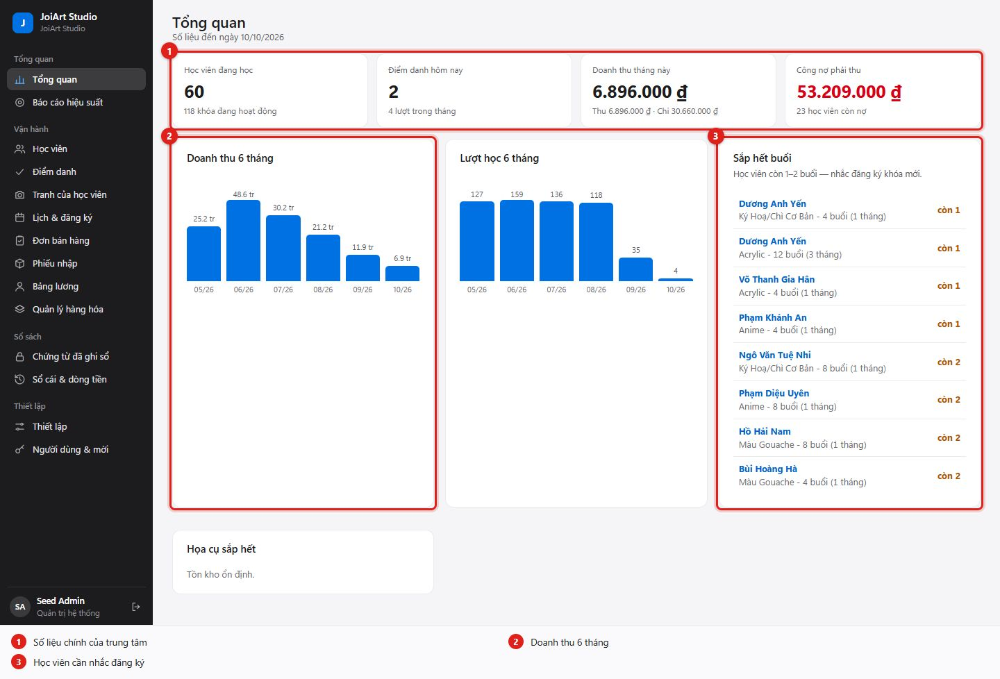

**Kết quả đúng**
- [ ] Bốn ô số liệu: học viên đang học, điểm danh hôm nay, doanh thu tháng này (kèm thu/chi), công nợ phải thu.
- [ ] Hai biểu đồ 6 tháng; hai danh sách việc cần làm: học viên **sắp hết buổi** (nhắc đăng ký khóa mới) và họa cụ sắp hết.

Nếu bị hỏi

- *Số liệu lấy từ đâu?* Từ chính các sổ cái (công nợ, buổi học, kho, quỹ), không nhập tay.
- *Doanh thu tính khi nào?* Khi ghi sổ đơn bán; đơn bị đảo ngược không tính.

---

### A2 · Học viên

| Ai | Ứng dụng | Thời lượng |
|---|---|---|
| L | Back-office | 4 phút |

**Mục tiêu:** tìm nhanh một học viên và xem mọi thứ về bạn đó ở một chỗ.

1. **Học viên** → gõ vài chữ của tên (không cần dấu) vào ô tìm kiếm. Bấm dòng học viên.

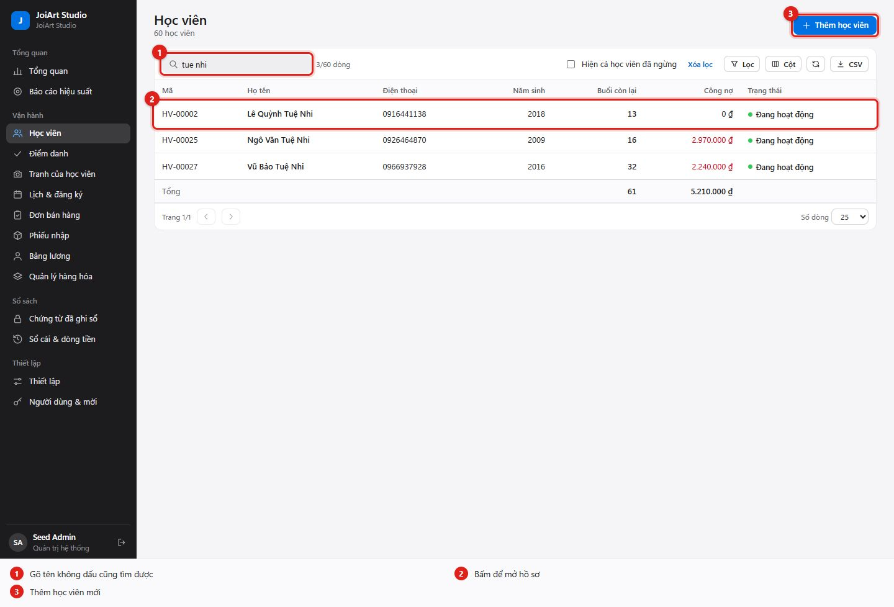

2. Hồ sơ mở ra với bốn con số luôn khớp sổ cái: **Đã mua** (tổng buổi các khóa đã mua), **Đã học** (buổi đã điểm danh), **Còn lại**, **Công nợ**; kèm các nút hành động và 5 tab. Nếu có buổi thuộc khóa tạm dừng/hủy thì có dòng giải thích vì sao Đã mua − Đã học ≠ Còn lại.

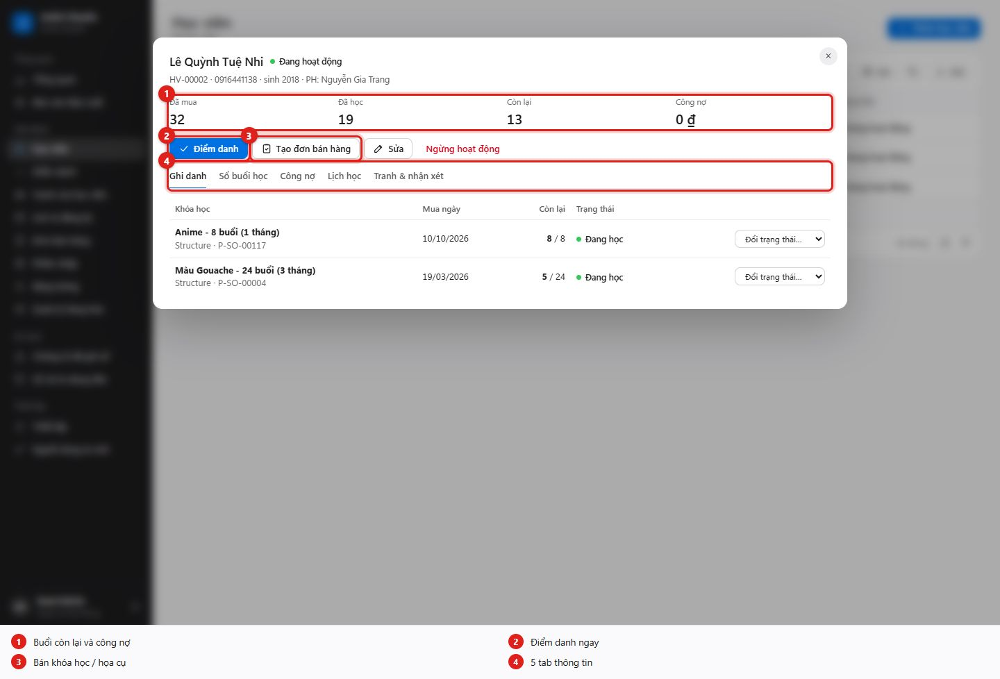

3. Lần lượt xem các tab: **Sổ buổi học** (từng buổi đã học/mua/hoàn), **Công nợ** (đơn và sổ công nợ, nút Thu tiền), **Lịch học** (ca thường đến và đăng ký trước theo ngày; không bắt buộc), **Tranh & nhận xét**.

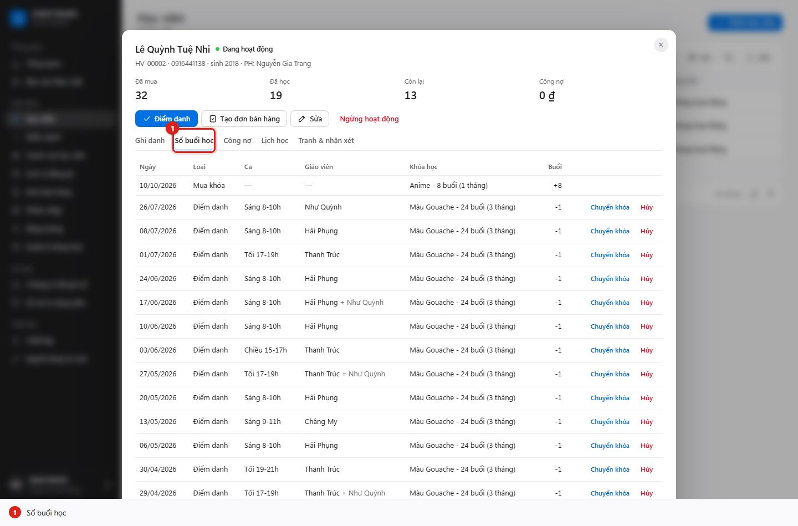

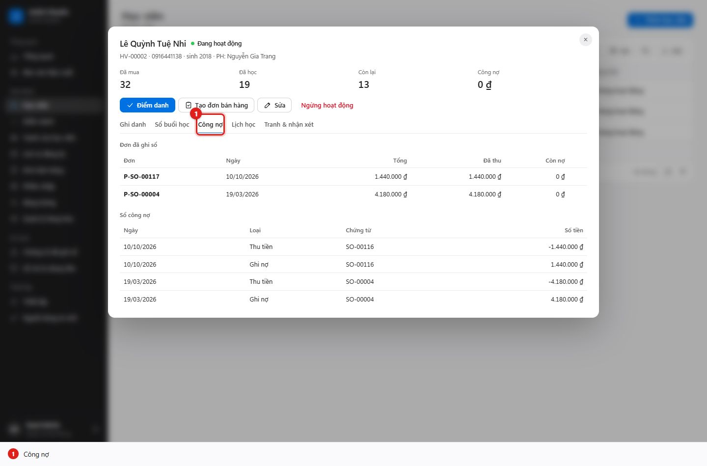

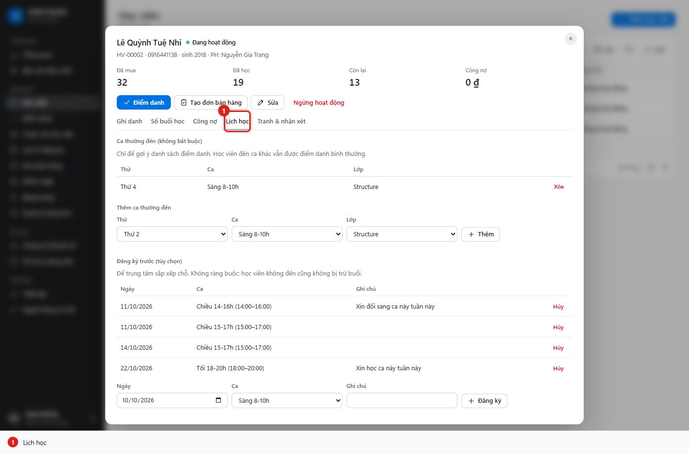

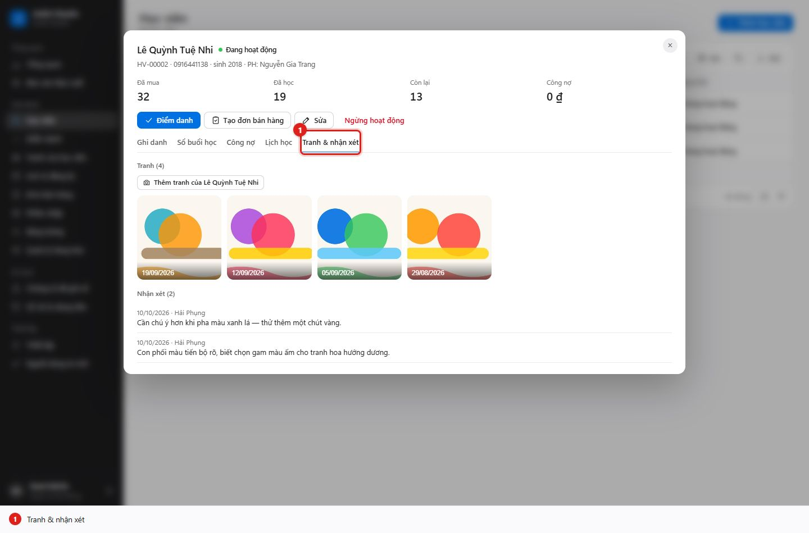

**Kết quả đúng**
- [ ] Tìm "nguyen" ra cả "Nguyễn"; có tìm theo mã và số điện thoại.
- [ ] Đã mua − Đã học − Còn lại = số buổi của các khóa tạm dừng/đã hủy (thường là 0).
- [ ] Mọi lưới danh sách đều có: lọc từng cột, sắp xếp, chọn cột hiển thị, xuất CSV, phân trang, nút làm mới.

Nếu bị hỏi

- *Xóa học viên?* Không xóa, chỉ **Ngừng hoạt động** (dữ liệu cũ giữ nguyên, bạn không còn xuất hiện khi điểm danh/bán hàng).
- *Có sửa nhầm được không?* Mọi thay đổi tiền và buổi học đi qua sổ cái nên đều truy vết được; xem A6, A7.

---

### A3 · Bán khóa học

| Ai | Ứng dụng | Thời lượng |
|---|---|---|
| L | Back-office | 6 phút |

**Mục tiêu:** bán một gói học cho học viên Lý Văn Phát, có giảm giá, thu tiền và ghi sổ trong một màn hình.

1. **Đơn bán hàng** → **Tạo đơn mới**.

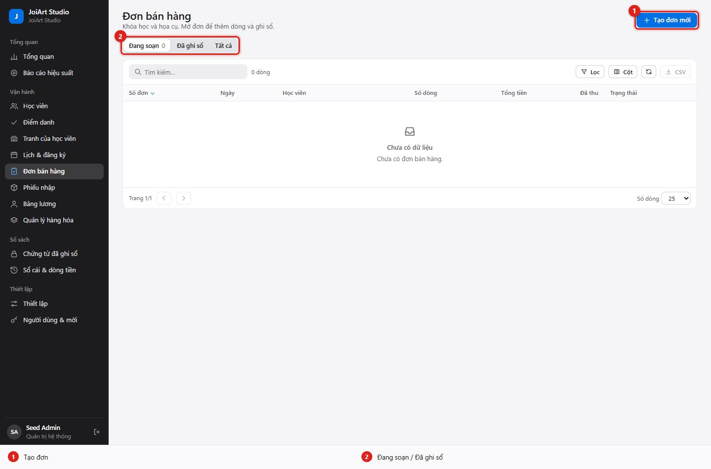

2. Gõ tên học viên vào ô **Học viên** (hoặc chọn từ gợi ý). Bấm **Khóa học**.

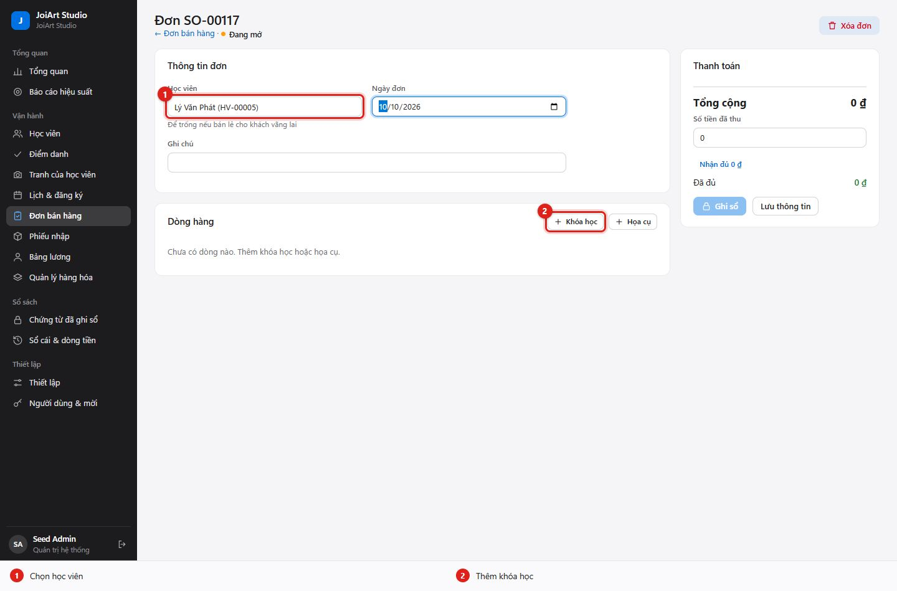

3. Chọn gói học (nhóm theo Lớp · Khóa học, giá tự điền). Nhập **Giảm giá** 100.000 và lý do. Bấm **Lưu dòng**.

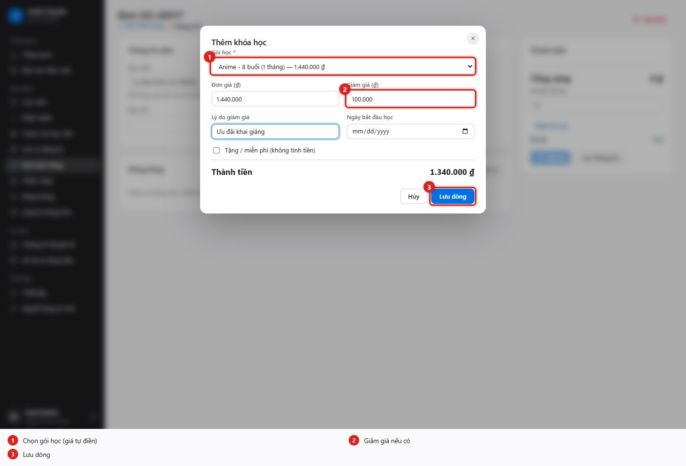

4. Bấm **Nhận đủ …** để điền số tiền đã thu, chọn tài khoản nhận tiền. Tổng tiền do hệ thống tính; **Đã đủ / Còn nợ** hiện ngay.

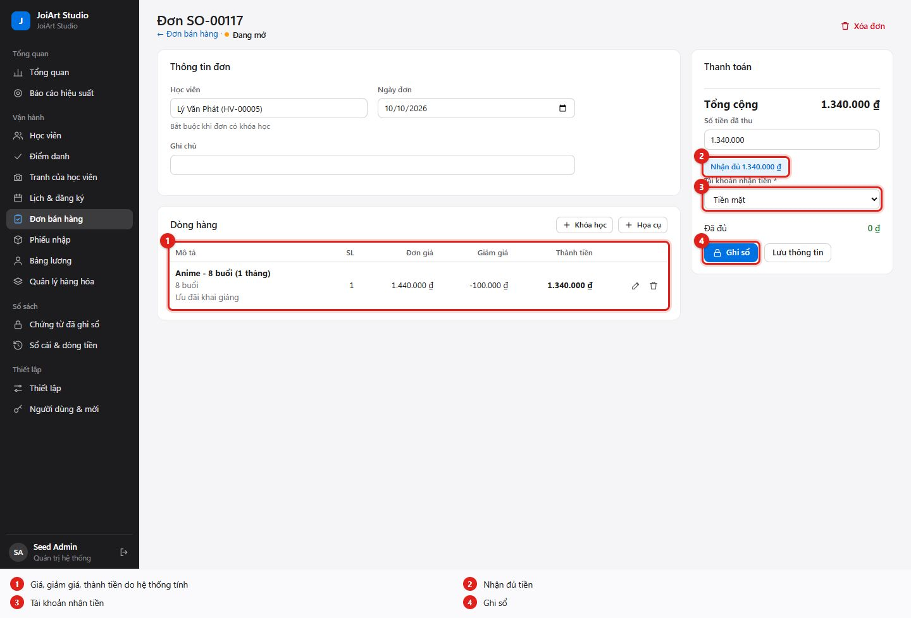

5. Bấm **Ghi sổ**; hộp xác nhận nêu số dòng, tổng tiền, đã thu và các cảnh báo (ví dụ còn nợ sẽ vào công nợ học viên). Bấm **Ghi sổ** để xác nhận.

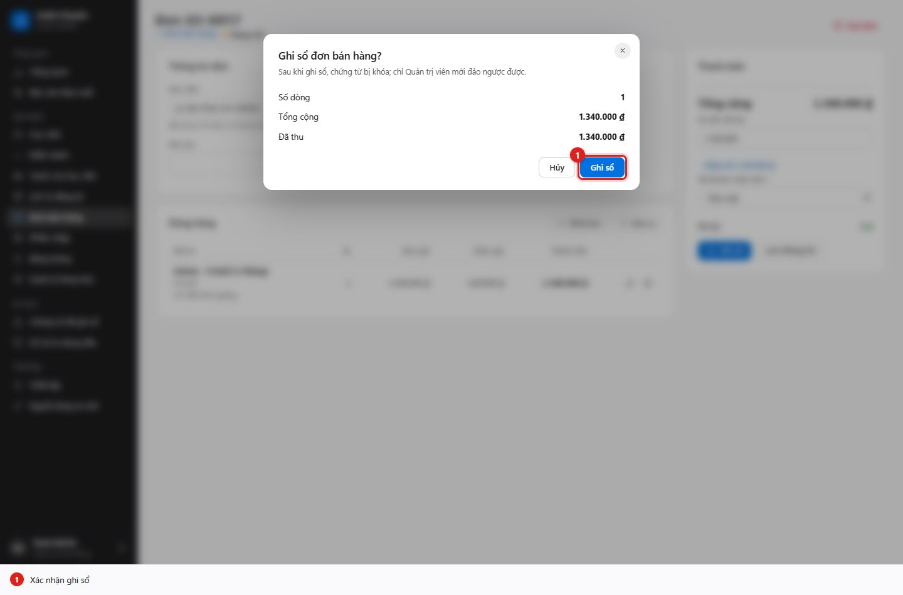

6. Đơn bị khóa. Mở hồ sơ học viên → tab **Ghi danh** thấy khóa mới còn đủ số buổi.

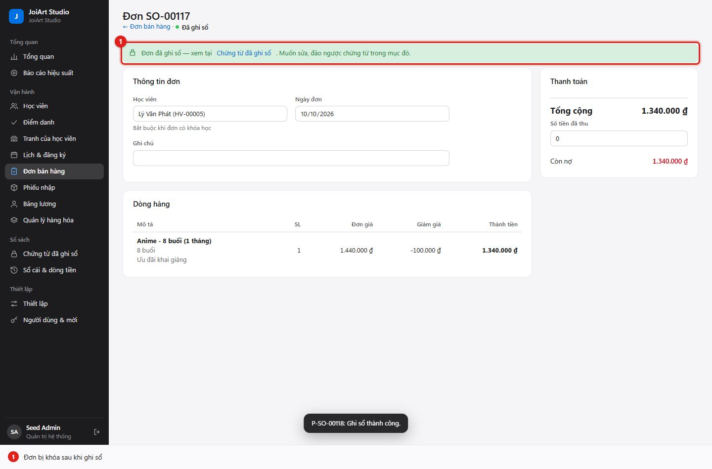

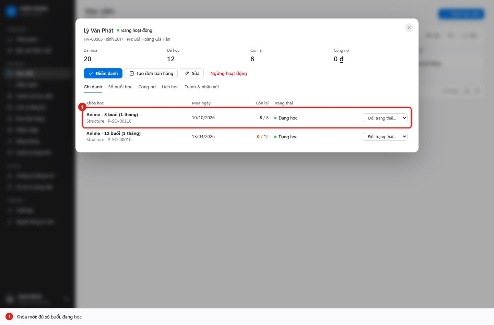

**Kết quả đúng**
- [ ] Không thể thu **nhiều hơn** tổng đơn (nút Ghi sổ bị khóa, có thông báo đỏ); khách lẻ (không chọn học viên) phải trả đủ vì không có công nợ để ghi.
- [ ] Nếu học viên trước đó đã học khi hết buổi (ghi nợ tạm), lúc ghi sổ hệ thống **tự trừ các buổi đó vào khóa vừa mua** và báo trong thông báo; không cần gán tay.
- [ ] Hai người cùng thu tiền một đơn cùng lúc: chỉ một lần được nhận, không bao giờ thu quá số nợ.
- [ ] Thành tiền = đơn giá − giảm giá; tổng đơn bằng tổng các dòng (không bao giờ sai lệch so với đã lưu).
- [ ] Đơn có khóa học mà chưa chọn học viên thì nút **Ghi sổ** bị khóa, có dòng nhắc.
- [ ] Ghi sổ hai lần liên tiếp (bấm đúp) chỉ tạo **một** chứng từ.
- [ ] Học viên có thêm một ghi danh với số buổi đúng gói; công nợ = tổng đơn − đã thu.

Nếu bị hỏi

- *Họa cụ?* Bấm **Họa cụ** để thêm dòng; ghi sổ sẽ trừ tồn kho và không cho bán quá số tồn. Có thể đánh dấu **Tặng / miễn phí** (vẫn trừ kho, không tính tiền).
- *Khách vãng lai mua họa cụ?* Để trống học viên; vẫn ghi vào sổ quỹ khi có thu tiền.
- *Sửa đơn sau khi ghi sổ?* Không sửa trực tiếp; Quản trị đảo ngược (A7) rồi bán lại.

---

### A4 · Thu nợ

| Ai | Ứng dụng | Thời lượng |
|---|---|---|
| L | Back-office | 3 phút |

**Mục tiêu:** thu phần còn nợ của một đơn đã ghi sổ.

1. **Chứng từ đã ghi sổ** → tick **Chỉ đơn còn nợ** → bấm một dòng.

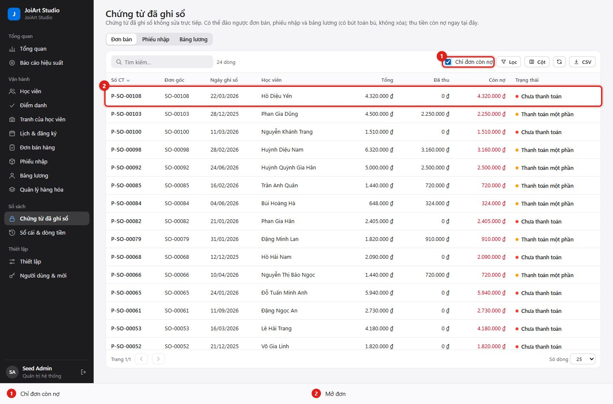

2. Cửa sổ chi tiết đơn → **Thu tiền**.

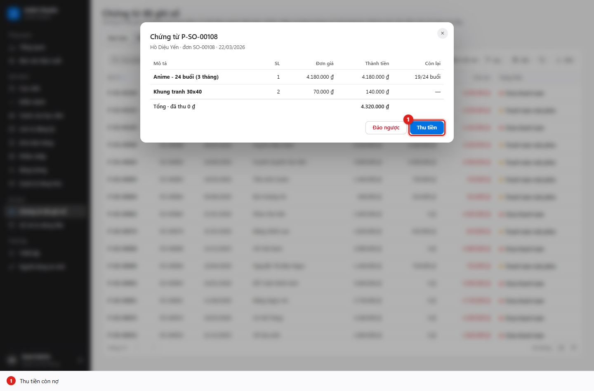

3. Số tiền mặc định là toàn bộ phần nợ (bấm **Thu đủ** để điền lại); chọn tài khoản nhận → **Ghi nhận thu tiền**.

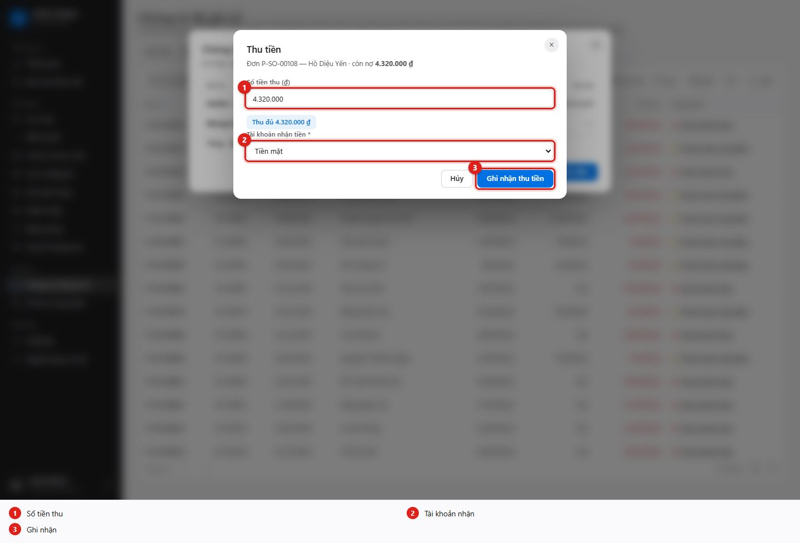

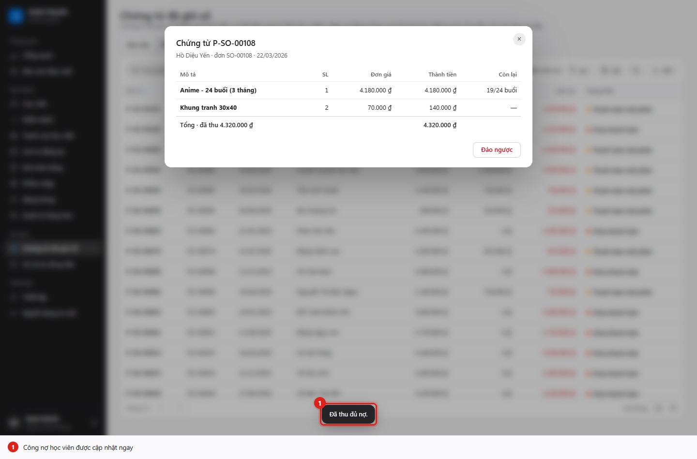

**Kết quả đúng**
- [ ] Không thu quá số còn nợ; thu một phần thì đơn chuyển sang **Thanh toán một phần**.
- [ ] Công nợ học viên giảm đúng số đã thu; sổ quỹ có thêm một khoản thu (A10).

---

### A5 · Điểm danh ở văn phòng

| Ai | Ứng dụng | Thời lượng |
|---|---|---|
| L | Back-office | 5 phút |

**Mục tiêu:** điểm danh đúng những học viên đến lớp, ca nào cũng được. **Văn phòng (Quản lý lớp học, Quản trị hệ thống) là nơi điểm danh cho cả học viên và giáo viên**: chọn giáo viên (và trợ giảng) dạy ca đó. Giáo viên chỉ thấy học viên đang trong ca của mình trên điện thoại (T2), không tự điểm danh.

**Nguyên tắc:** học viên **không bắt buộc học cố định**, có thể đến bất kỳ ca nào. Có đăng ký trước hay không đều được. Danh sách trong mỗi ca chỉ là **gợi ý** (Đã đăng ký cho đúng ngày đó / Thường đến vào thứ này); mặc định **không ai được chọn**, học viên đến thì tick đúng bạn đó.

1. **Điểm danh** → tab **Điểm danh theo ca**. Mỗi ca liệt kê các bạn **Đã đăng ký** (cho đúng ngày) và **Thường đến** (đúng thứ). Tick bạn nào đã đến; bạn chưa có tên thì gõ tên hoặc mã vào ô tìm ngay dưới ca để thêm (nhãn **Đến thêm**). Chọn giáo viên (và trợ giảng nếu có), bấm **Điểm danh N học viên**. Bạn có nhiều khóa còn buổi thì chọn khóa bị trừ ngay trong dòng.

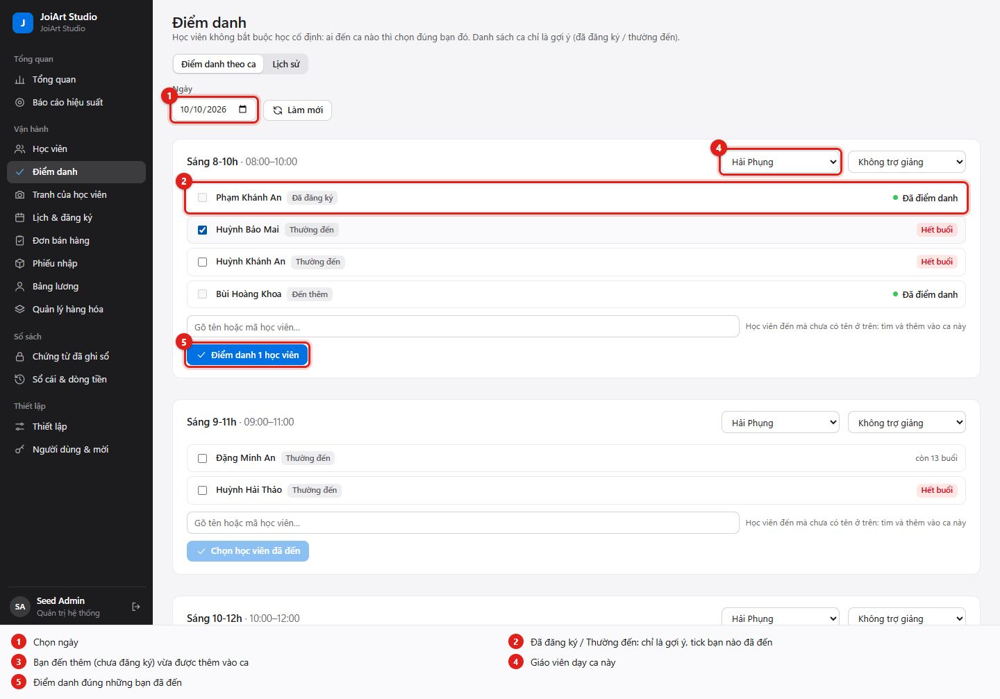

2. Các bạn đã điểm danh hiện **Đã điểm danh** và bị trừ 1 buổi; ngay sau đó giáo viên của ca thấy các bạn này trong ứng dụng của mình.

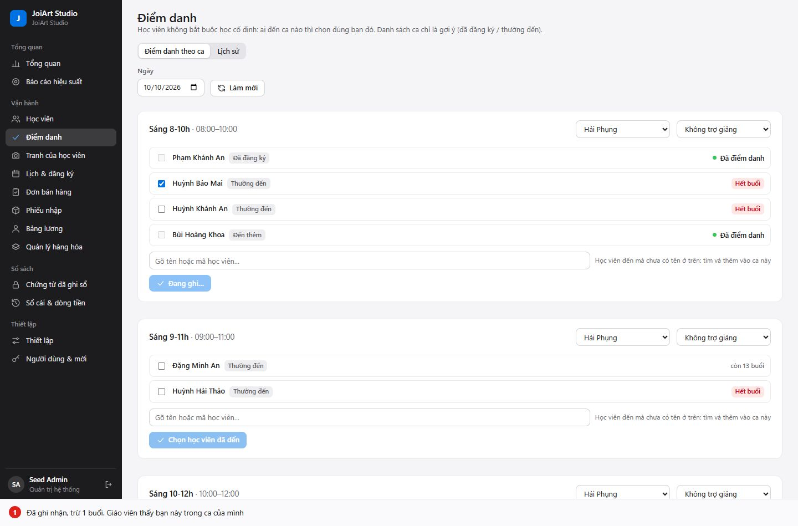

3. Từ hồ sơ một học viên bấm **Điểm danh**: chọn ca, giáo viên; tick **Buổi học thử** nếu là học thử (không trừ buổi); ghi chú buổi học.

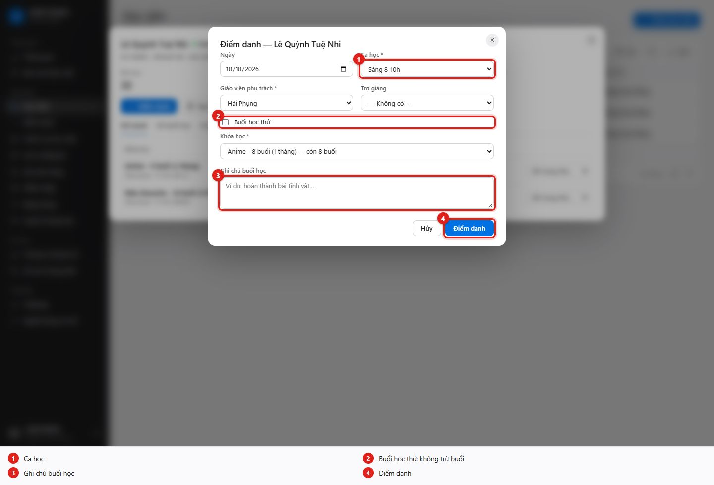

4. Tab **Lịch sử** liệt kê từng lượt theo khoảng ngày.

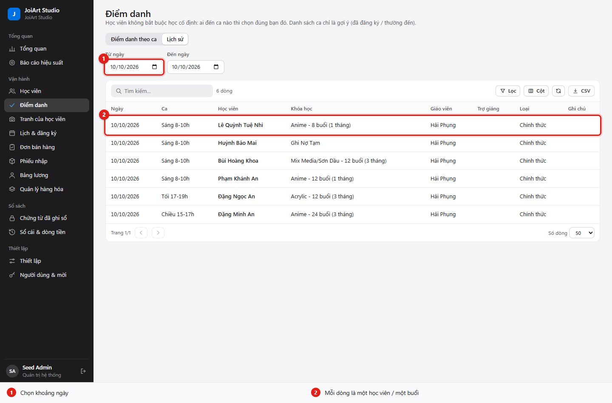

5. **Đăng ký trước (tùy chọn)**: hồ sơ học viên → tab **Lịch học** có hai phần: **Ca thường đến** (theo thứ, chỉ gợi ý) và **Đăng ký trước** (theo ngày cụ thể, kèm ghi chú). Đăng ký trước chỉ để trung tâm sắp xếp chỗ: không ràng buộc, không trừ buổi, bạn không đến cũng không sao. Phụ huynh thấy các buổi này trong ứng dụng (P1).

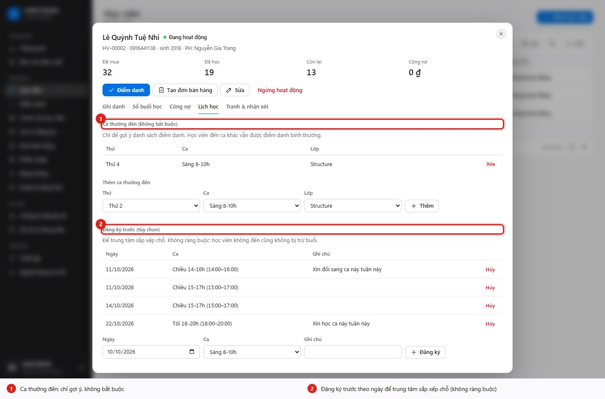

**Kết quả đúng**
- [ ] Điểm danh cùng học viên, cùng ca, cùng ngày lần hai bị từ chối (không trừ buổi lần nữa); khác ca trong ngày vẫn được.
- [ ] Học viên hết buổi: nếu bật **Cho phép học nợ** (A12) thì ghi vào **Ghi Nợ Tạm**, sau này gán sang khóa thật (A6); nếu không bật thì báo hết buổi.
- [ ] Học viên có nhiều khóa còn buổi: phải chọn khóa nào bị trừ.
- [ ] Học viên không có lịch cố định và chưa đăng ký vẫn điểm danh được ở bất kỳ ca nào (gõ tên vào ô tìm dưới ca).
- [ ] Không thể đăng ký trước cho ngày đã qua; không đăng ký trùng một ca.

Nếu bị hỏi

- *Danh sách ca lấy từ đâu?* Chỉ để gợi ý: lấy từ **Đăng ký trước** của ngày đó và **Ca thường đến** của thứ đó (A2 tab Lịch học). Không ràng buộc; học viên đến ca khác thì thêm bằng ô tìm bên dưới ca.
- *Khóa học hết hạn?* Hệ thống tính theo số buổi; khi dùng hết buổi khóa tự chuyển **Hoàn thành**.

---

### A6 · Hủy hoặc chuyển buổi điểm danh

| Ai | Ứng dụng | Thời lượng |
|---|---|---|
| L (trong ngày), Q (bất cứ lúc nào) | Back-office | 3 phút |

**Mục tiêu:** sửa nhầm điểm danh mà vẫn giữ nguyên lịch sử.

1. Hồ sơ học viên → tab **Sổ buổi học**. Mỗi buổi điểm danh còn sửa được có nút **Hủy** và **Chuyển khóa** (một nút duy nhất, kể cả buổi đang ghi nợ tạm).

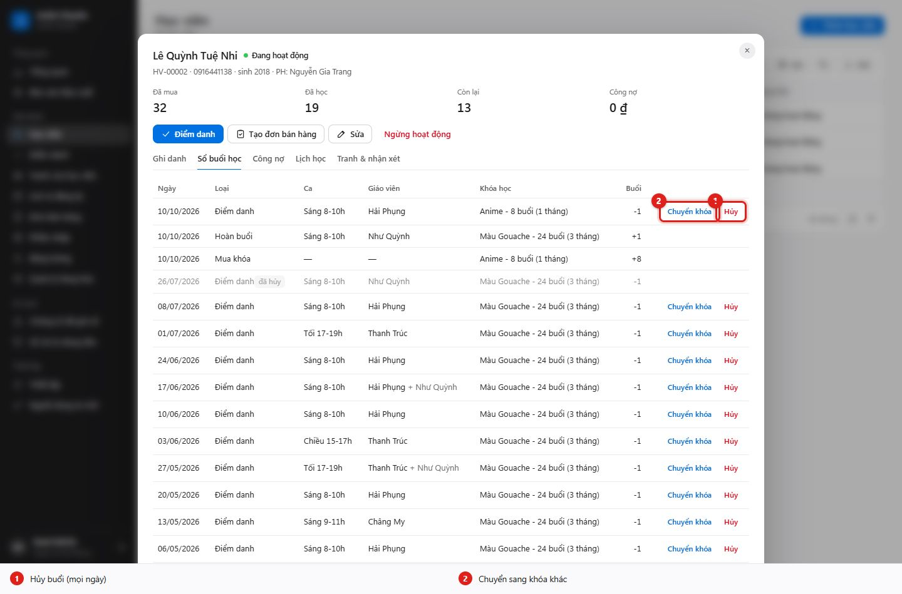

2. **Hủy** → xác nhận.

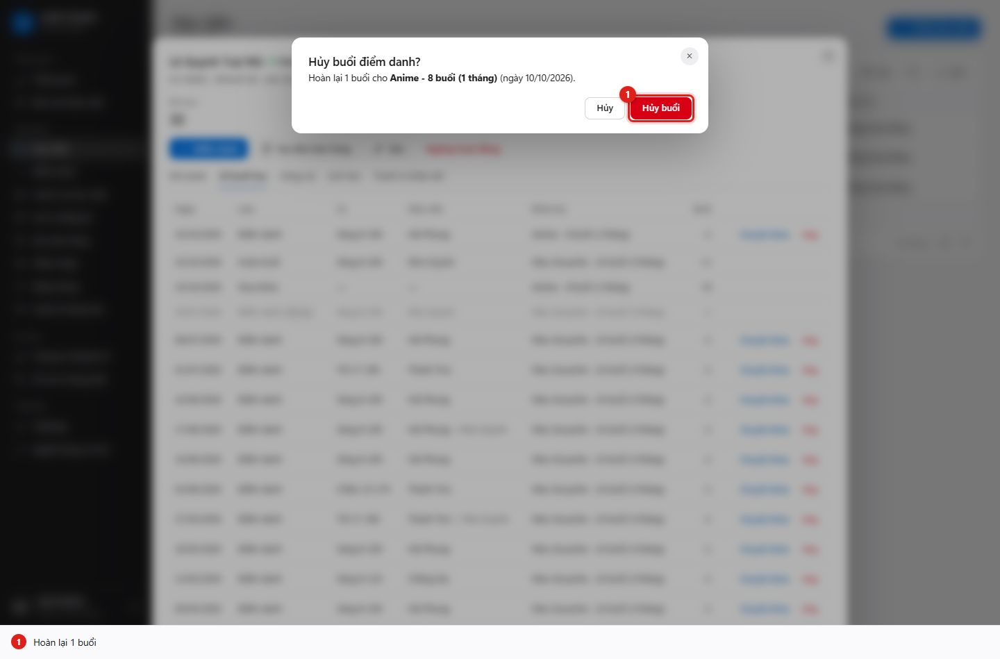

3. Buổi cũ được đánh dấu **đã hủy**, hệ thống thêm một bút toán hoàn 1 buổi; số buổi còn lại tăng lại.

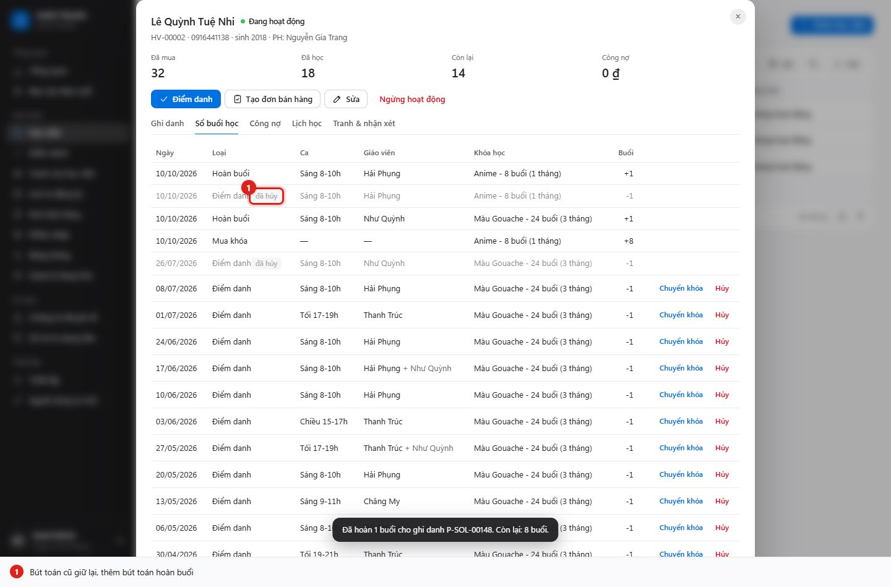

**Kết quả đúng**
- [ ] Quản lý lớp học và Quản trị hệ thống đều hủy/chuyển được buổi của mọi ngày (có bút toán, không xóa).
- [ ] Không hủy hai lần cùng một buổi. Khóa đã **Hoàn thành** mà được hoàn buổi thì tự trở lại **Đang học**.

---

### A7 · Đảo ngược đơn bán

| Ai | Ứng dụng | Thời lượng |
|---|---|---|
| L, Q | Back-office | 3 phút |

**Mục tiêu:** hủy một đơn đã ghi sổ nhầm, đúng cách kế toán (bút toán bù trừ, không xóa).

1. **Chứng từ đã ghi sổ** → mở đơn vừa bán ở A3 → **Đảo ngược**.

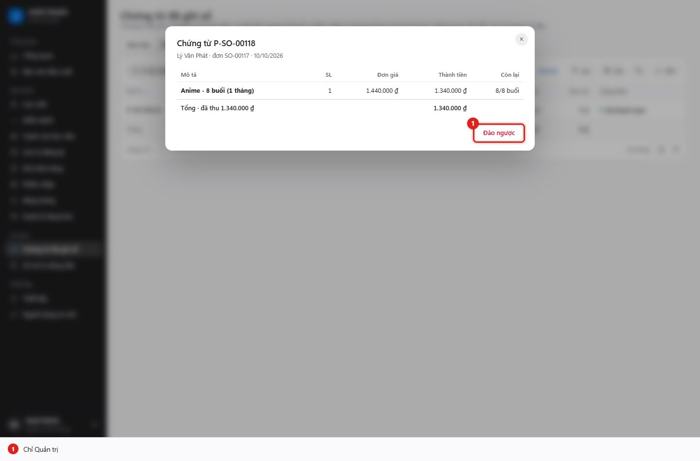

2. Đọc câu cảnh báo → **Đảo ngược**.

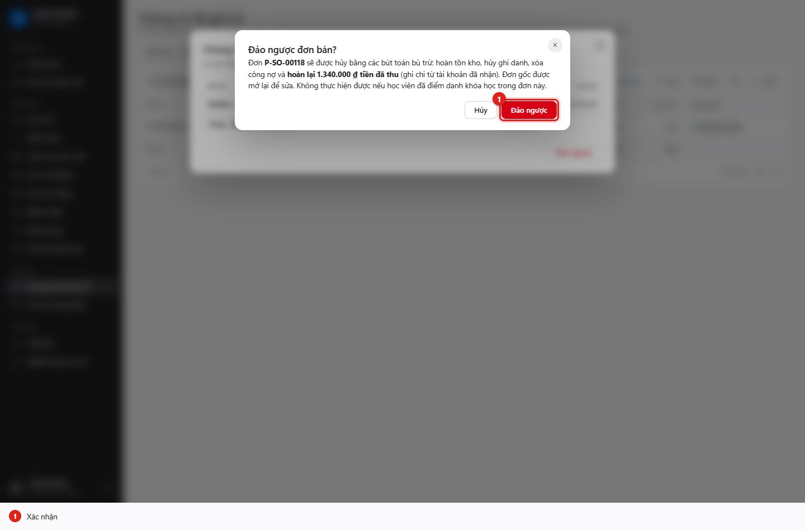

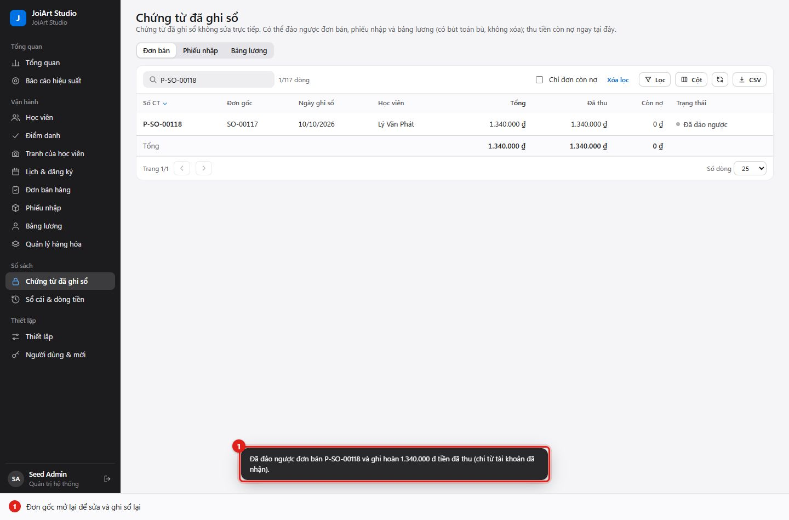

**Kết quả đúng**
- [ ] Chứng từ gốc được giữ nguyên, thêm các bút toán bù: hoàn tồn kho, hủy ghi danh, xóa công nợ và **hoàn lại tiền đã thu** (ghi chi từ đúng tài khoản đã nhận). Sau đảo ngược, sổ quỹ và công nợ của đơn đó cộng lại bằng 0. Đơn gốc mở lại để sửa và ghi sổ lại.
- [ ] Bị chặn nếu học viên **đã điểm danh** khóa trong đơn (hủy điểm danh trước, A6).
- [ ] Cả Quản lý lớp học và Quản trị hệ thống đều có nút này; giáo viên, phụ huynh thì không.

---

### A8 · Nhập họa cụ

| Ai | Ứng dụng | Thời lượng |
|---|---|---|
| L | Back-office | 4 phút |

**Mục tiêu:** nhập hàng từ nhà cung cấp, tồn kho và giá vốn tự cập nhật, tiền chi ra từ tài khoản.

1. **Phiếu nhập** → **Tạo phiếu nhập**. Nhập nhà cung cấp, bấm **Thêm dòng**: chọn hàng hóa, số lượng, đơn giá nhập.

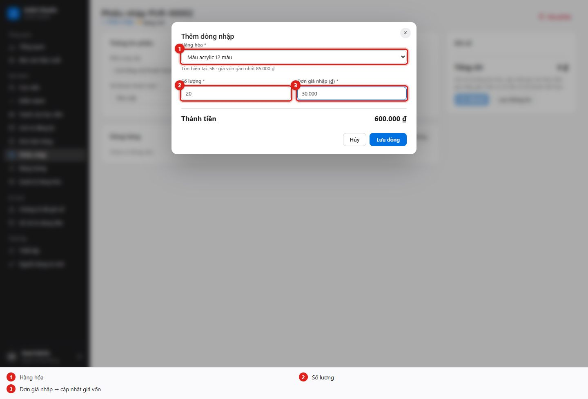

2. Chọn **Tài khoản thanh toán** → **Ghi sổ**.

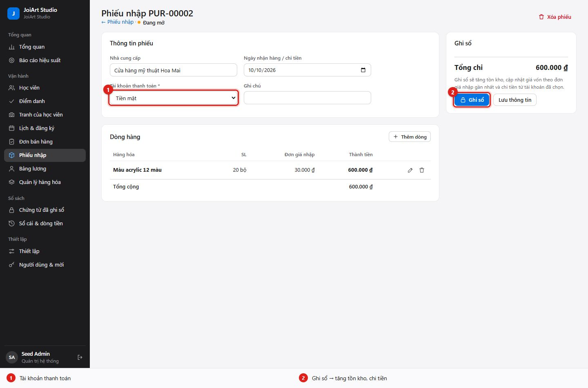

3. **Quản lý hàng hóa**: tồn kho tăng, giá vốn cập nhật theo đơn giá nhập gần nhất.

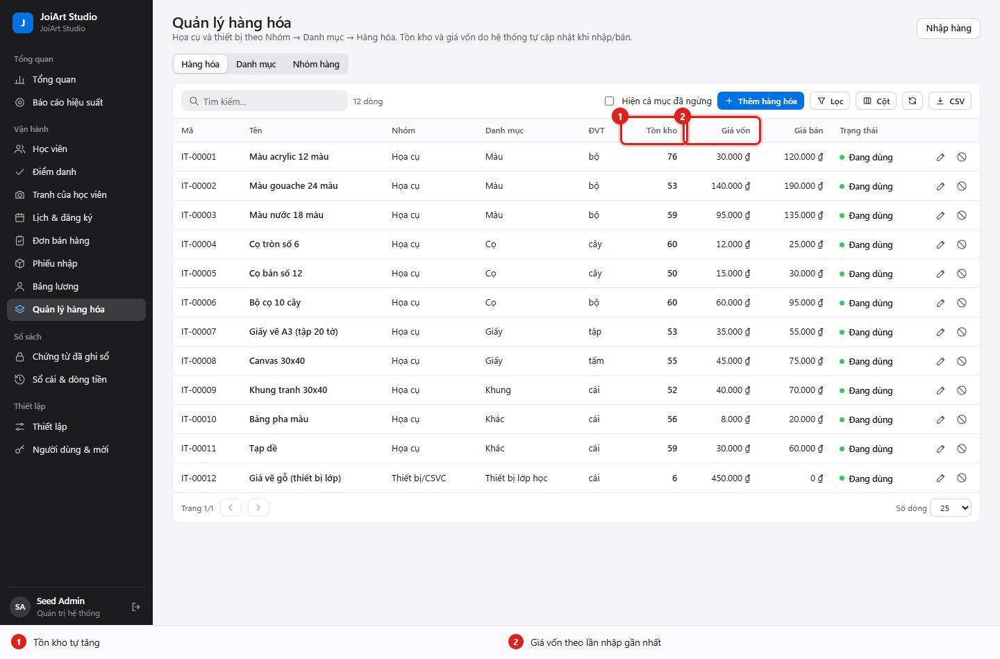

**Kết quả đúng**
- [ ] Tồn kho = tổng nhập − tổng bán; sổ quỹ có một khoản chi đúng tổng phiếu, ghi vào ngày nhận hàng.
- [ ] Đảo ngược phiếu nhập bị chặn nếu hàng đã bán bớt, không đủ tồn để trừ lại.

---

### A9 · Bảng lương giáo viên

| Ai | Ứng dụng | Thời lượng |
|---|---|---|
| L, Q | Back-office | 5 phút |

**Mục tiêu:** lập bảng lương một kỳ, với gợi ý tự tính từ số buổi đã dạy.

1. **Bảng lương** → **Tạo bảng lương** → chọn giáo viên và tháng. Hệ thống gợi ý: lương cứng và/hoặc **số buổi dạy × đơn giá buổi** (một buổi dạy = một ca trong ngày, không đếm theo số học viên). Bấm gợi ý để thêm.

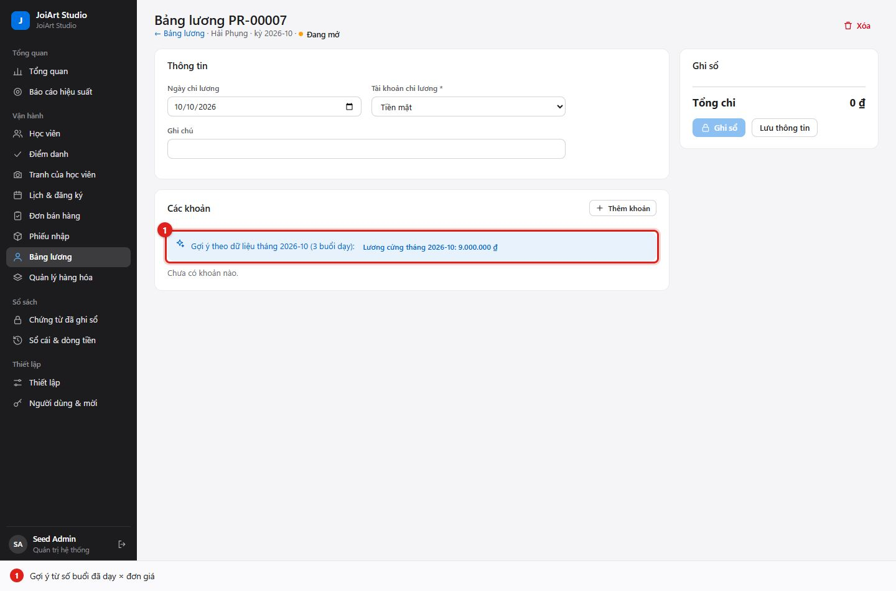

2. **Thêm khoản** để thêm thưởng hoặc **Khấu trừ** (nhập số dương, hệ thống tự lưu âm). Chọn tài khoản chi lương → **Ghi sổ**.

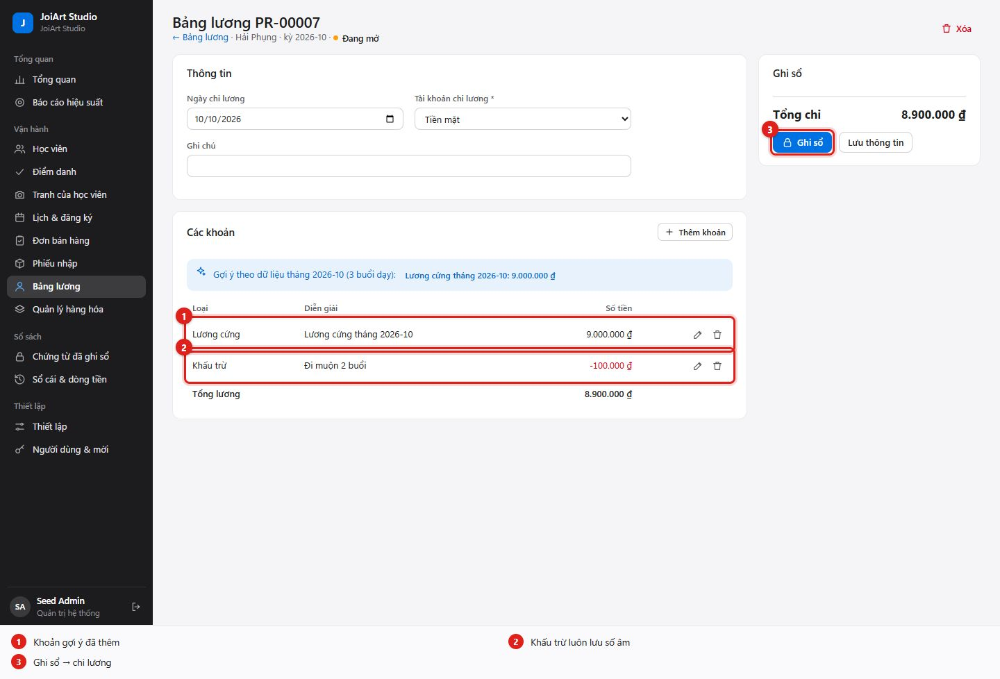

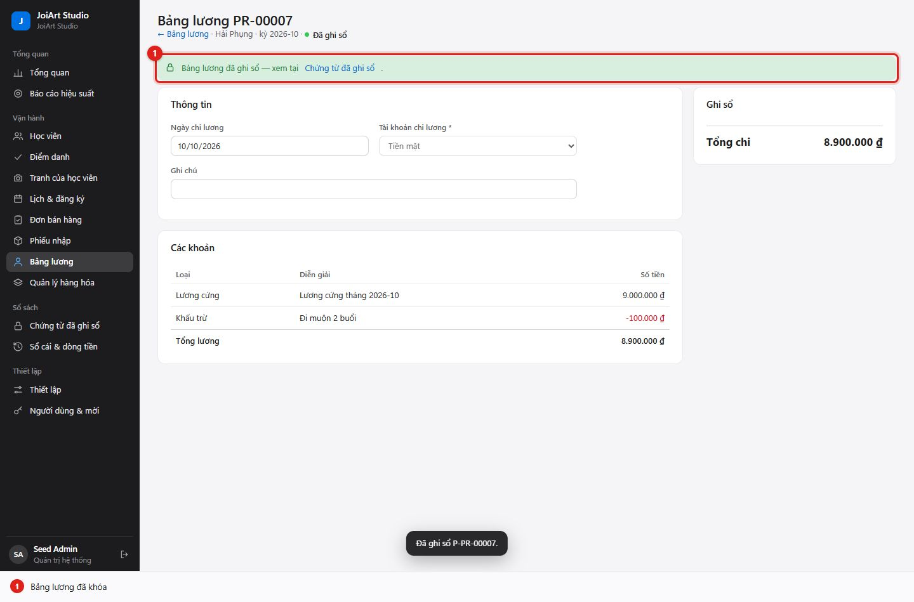

**Kết quả đúng**
- [ ] Tổng lương = tổng các khoản (khấu trừ trừ đi). Gợi ý chỉ là gợi ý, sửa được; không tự ghi.
- [ ] Ghi sổ ghi một khoản chi vào sổ quỹ đúng ngày chi lương và hai bút toán sổ nhân viên (phải trả rồi đã trả).
- [ ] Không trả trùng: nếu giáo viên đã được trả lương cứng / lương theo buổi của tháng đó thì bảng lương hiện cảnh báo và ghi sổ bị chặn. Lập nhầm thì **Đảo ngược** bảng cũ ở Chứng từ đã ghi sổ (tiền hoàn lại tài khoản đã chi, bảng gốc mở lại để sửa).

---

### A10 · Sổ cái và đối soát

| Ai | Ứng dụng | Thời lượng |
|---|---|---|
| Q | Back-office | 3 phút |

**Mục tiêu:** cho thấy mọi con số có nguồn gốc, và có nút kiểm lại.

1. **Sổ cái & dòng tiền**: 6 sổ (Sổ quỹ, Công nợ học viên, Sổ buổi học, Sổ kho, Giá trị hàng, Sổ nhân viên). Sổ quỹ lọc theo tài khoản và khoảng ngày.

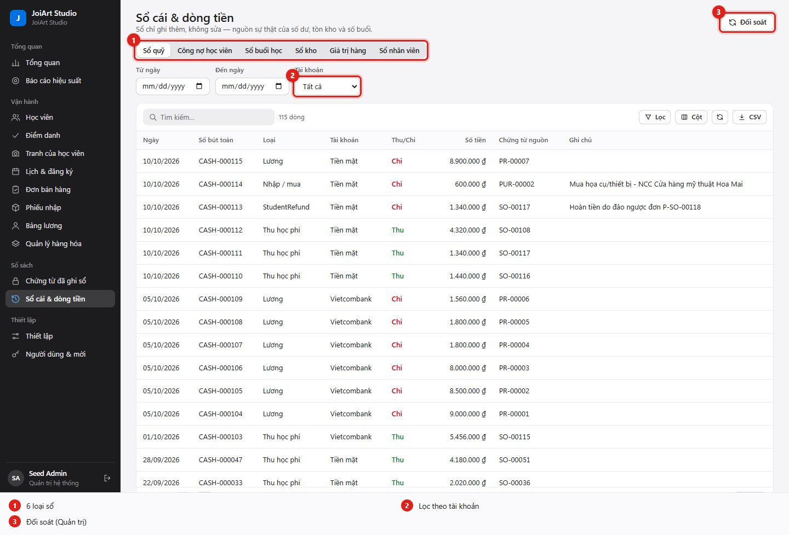

2. **Đối soát**: tính lại công nợ, số buổi và tồn kho từ sổ cái.

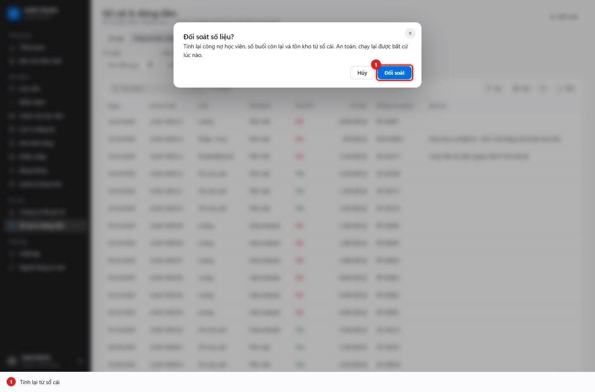

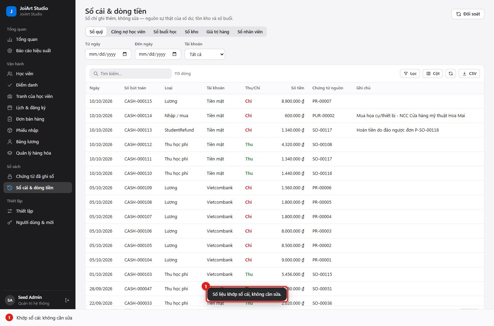

**Kết quả đúng**
- [ ] Sổ chỉ ghi thêm, không có nút sửa/xóa.
- [ ] Đối soát báo "Số liệu khớp sổ cái" khi mọi thứ bình thường; nếu có lệch (ví dụ sửa tay trong CSDL) sẽ báo đã sửa bao nhiêu.

---

### A11 · Báo cáo hiệu suất và lịch học

| Ai | Ứng dụng | Thời lượng |
|---|---|---|
| Q | Back-office | 3 phút |

1. **Báo cáo hiệu suất**: chọn khoảng ngày và nhóm theo ngày/tuần/tháng/năm — doanh thu (khóa học, họa cụ), giá vốn, lương, biên lợi nhuận ước tính, số buổi dạy từng giáo viên, doanh thu theo lớp.

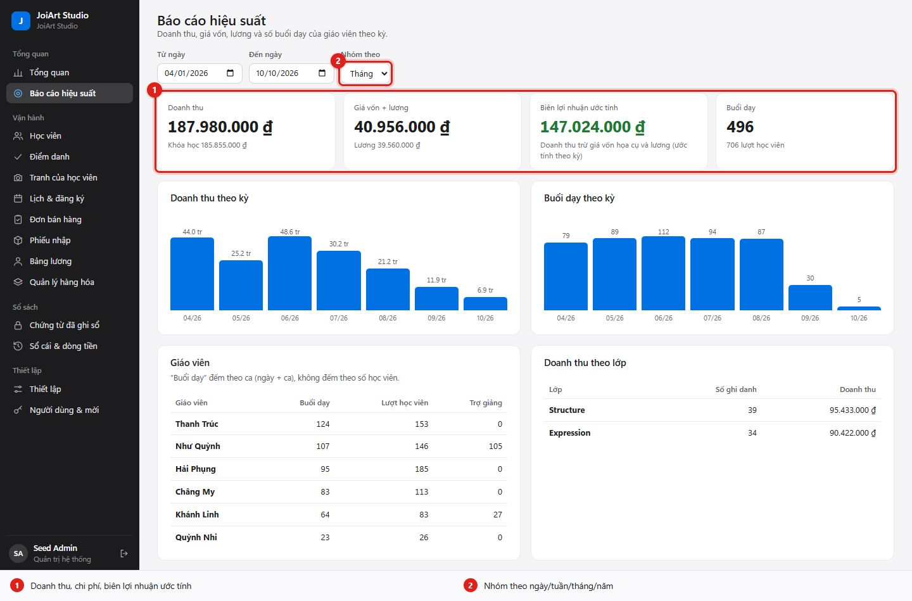

2. **Lịch học dự kiến**: bảng tuần theo ca và thứ, tổng hợp từ lịch học đã đăng ký của từng học viên; bấm ô để xem danh sách tên.

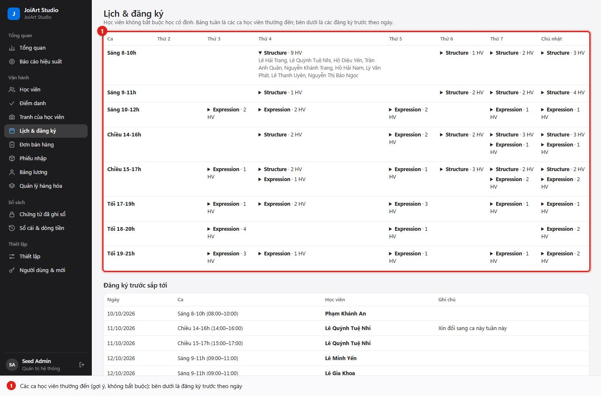

Nếu bị hỏi

- *Biên lợi nhuận chính xác không?* Là ước tính theo kỳ (doanh thu trừ giá vốn họa cụ và lương cùng kỳ), không gắn từng buổi học với từng khoản lương.
- *Buổi dạy tính thế nào?* Đếm ca (ngày + ca + giáo viên), không đếm số học viên; cột "lượt học viên" đếm riêng.

---

### A12 · Thiết lập và mã mời

| Ai | Ứng dụng | Thời lượng |
|---|---|---|
| Q | Back-office | 4 phút |

1. **Thiết lập** → **Học phí (gói học)**: Lớp → Khóa học → Gói học, giá từng gói. Các tab còn lại: Ca học, Giáo viên, Tài khoản (tiền mặt, ngân hàng), và danh mục họa cụ ở **Quản lý hàng hóa**.

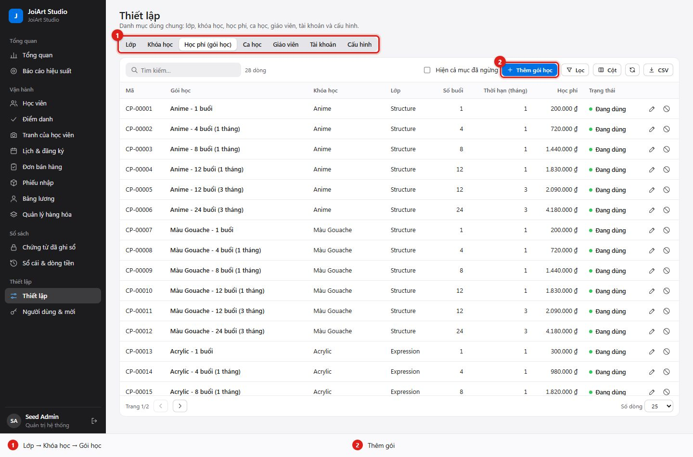

2. Tab **Cấu hình** (chỉ **Quản trị hệ thống** đổi được; Quản lý lớp học chỉ xem): **Cho phép học nợ** (điểm danh được khi đã hết buổi, ghi vào Ghi Nợ Tạm; khi học viên mua khóa mới, các buổi nợ **tự được trừ vào khóa vừa mua**) và **Gói dùng cho buổi học thử** (không trừ buổi).

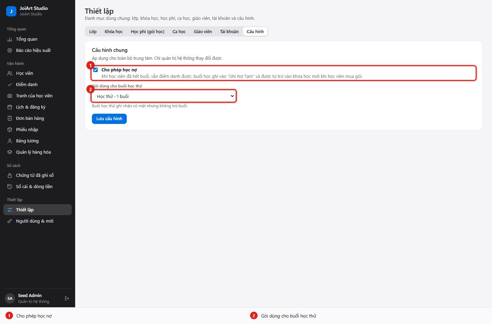

3. **Người dùng & mã mời** → **Tạo mã mời**: chọn vai trò (Giáo viên / Phụ huynh / Học viên / Quản lý lớp học; chỉ Quản trị hệ thống mời được thêm Quản trị hệ thống) và gắn với giáo viên hoặc học viên.

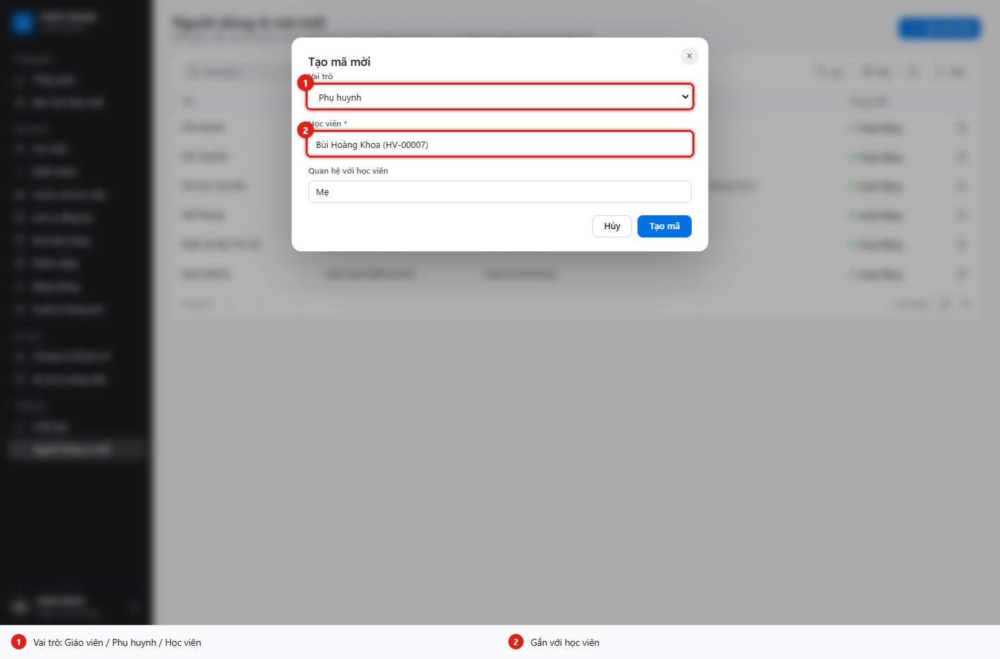

4. Gửi mã 8 ký tự cho người được mời. Mã dùng một lần, hết hạn sau 14 ngày.

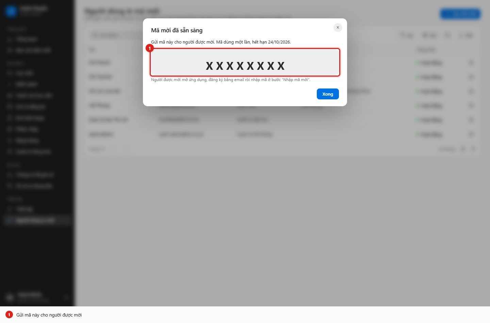

**Kết quả đúng**
- [ ] Người được mời đăng ký bằng email rồi nhập mã ở lần đầu mở ứng dụng (T0, P0) là có đúng vai trò và đúng dữ liệu của mình.
- [ ] Có thể khóa/mở khóa tài khoản trong danh sách người dùng; không tự khóa chính mình; Quản lý lớp học không khóa được tài khoản Quản trị hệ thống.

---

### A13 · Phân quyền

| Ai | Ứng dụng | Thời lượng |
|---|---|---|
| L (đăng nhập bằng tài khoản Quản lý lớp học) | Back-office | 3 phút |

Hai vai trò nhân viên: **Quản lý lớp học** làm mọi việc vận hành hằng ngày và toàn quyền trên dữ liệu; **Quản trị hệ thống** có thêm quyền thiết đặt hệ thống.

1. Đăng nhập bằng tài khoản **Quản lý lớp học**: thanh bên có đủ các mục vận hành, sổ sách, Thiết lập danh mục và Người dùng.

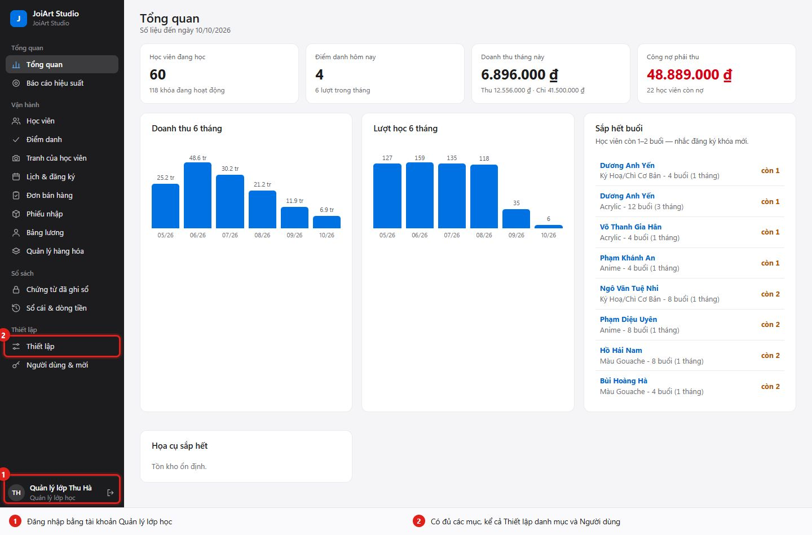

2. Mở một đơn đã ghi sổ: có **Thu tiền** và **Đảo ngược**.

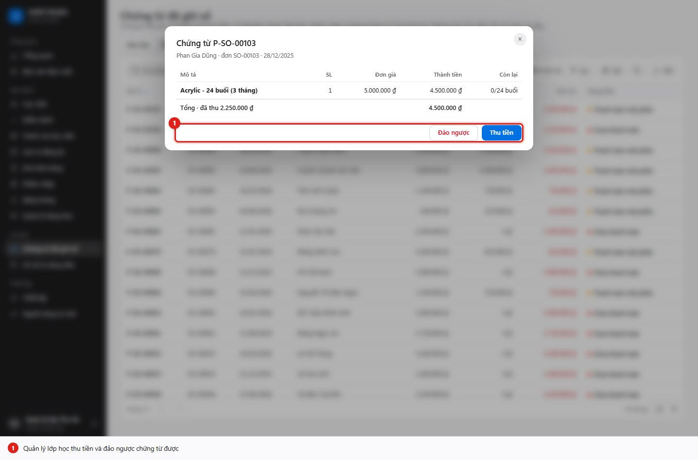

3. **Thiết lập → Cấu hình**: chỉ xem. Cho phép học nợ và gói học thử là thiết đặt hệ thống, do Quản trị hệ thống đổi.

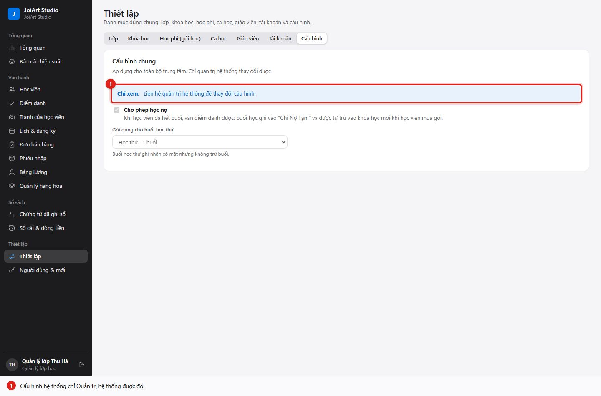

**Bảng quyền**

| | Quản trị hệ thống | Quản lý lớp học | Giáo viên | Phụ huynh / học viên |
|---|---|---|---|---|
| Cấu hình chung (cho phép học nợ, gói học thử) | **Sửa** | Chỉ xem | — | — |
| Tạo tài khoản Quản trị hệ thống, khóa/mở khóa tài khoản đó | **Có** | Không | — | — |
| Danh mục (lớp, khóa học, gói học, ca, giáo viên, họa cụ, tài khoản quỹ) | Sửa | Sửa | Chỉ xem một phần | — |
| Học viên, bán khóa học, thu nợ, nhập hàng, bảng lương | Có | Có | — | — |
| Điểm danh cả học viên và giáo viên; hủy / chuyển điểm danh mọi ngày | Có | Có | Không điểm danh; chỉ thấy học viên trong ca của mình | — |
| Đảo ngược đơn bán, phiếu nhập, bảng lương; đối soát; mời giáo viên, phụ huynh | Có | Có | Không | — |
| Tiền và số điện thoại học viên | Thấy | Thấy | **Không thấy** | Chỉ của con mình |
| Tranh và nhận xét | Thấy hết | Thấy hết | Thấy hết, sửa của mình | Chỉ phần được chia sẻ, chỉ của con mình |

Quyền được kiểm tra ở máy chủ (không chỉ ẩn nút) và có kiểm thử tự động, kể cả "phụ huynh A không đọc được con của phụ huynh B".
