# App giáo viên

Ứng dụng web cài lên điện thoại (PWA) dành cho giáo viên (G): `…/teacher/`. Ảnh chụp ngày 10/10/2026, khung điện thoại 390×844. Tên học viên và số buổi trong ảnh chỉ là dữ liệu mẫu.

| Mã | Case | Phút | Ai |
|---|---|---|---|
| [T0](#t0--vào-bằng-linkqr-hoặc-mã-mời) | Vào bằng link / QR (hoặc mã mời) lần đầu | 2 | G mới |
| [T1](#t1--hôm-nay) | Màn hình **Hôm nay**: các ca học | 1 | G |
| [T2](#t2--học-viên-trong-ca) | Học viên trong ca: chỉ thấy bạn đã được văn phòng điểm danh | 2 | G |
| [T3](#t3--chụp-tranh-của-học-viên) | Chụp tranh của học viên | 3 | G |
| [T4](#t4--nhận-xét) | Viết nhận xét cho phụ huynh | 2 | G |
| [T5](#t5--hồ-sơ-học-viên) | Hồ sơ học viên: khóa học, tranh, nhận xét | 2 | G |
| [T6](#t6--tranh-gần-đây) | Tranh mới chụp của mọi học viên | 1 | G |

Thứ tự trình bày: T0 → T1 → T2 → T3 → T4 → T5 → T6.

---

### T0 · Vào bằng link / QR (hoặc mã mời)

| Ai | Ứng dụng | Thời lượng |
|---|---|---|
| Cô Như Quỳnh (G mới) | App giáo viên | 2 phút |

**Mục tiêu:** giáo viên vào đúng hồ sơ giáo viên mà văn phòng đã tạo, không cần đăng ký email.

**Cách chính:** văn phòng vào **Người dùng & mời → Tài khoản giáo viên (link / QR)** (A15), chọn giáo viên, gửi link hoặc cho quét mã QR. Giáo viên mở link một lần trên điện thoại là vào thẳng ứng dụng, thiết bị nhớ đăng nhập.

**Cách phụ (đã có tài khoản email):**

1. Quản trị tạo mã mời cho giáo viên (A12) và gửi mã. Giáo viên mở `…/teacher/` → **Đăng nhập bằng email** → màn **Chào mừng**.

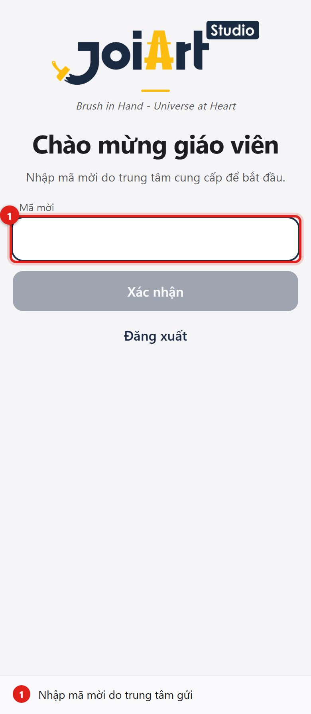

2. Nhập mã → **Xác nhận**.

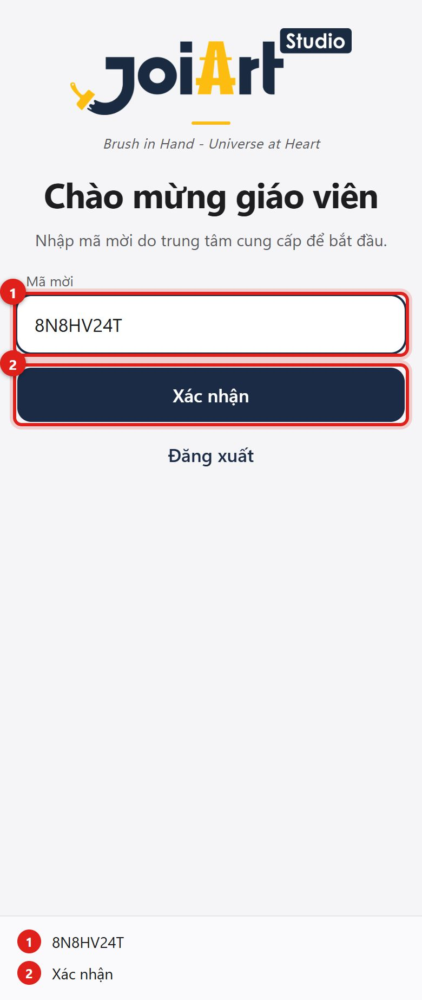

3. Vào thẳng màn **Hôm nay**.

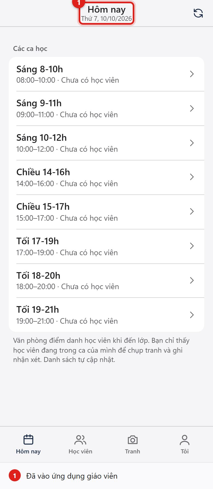

**Kết quả đúng**
- [ ] Mã dùng được một lần; nhập lại mã đã dùng báo "không hợp lệ hoặc đã hết hạn".
- [ ] Lần đăng nhập sau vào thẳng ứng dụng, không hỏi mã.

Nếu bị hỏi

- *Cài như app?* Chrome Android: menu **⋮** → **Thêm vào màn hình chính**; iPhone Safari: **Chia sẻ** → **Thêm vào MH chính**. Không cần App Store.
- *Mất điện thoại?* Văn phòng bấm **Tạo lại link / QR** ở **Người dùng & mời** (đăng xuất luôn thiết bị cũ) và gửi link mới. Với tài khoản email: khóa tài khoản rồi cấp lại.

---

### T1 · Hôm nay

| Ai | Ứng dụng | Thời lượng |
|---|---|---|
| G | App giáo viên | 1 phút |

1. Màn **Hôm nay** liệt kê các ca; mỗi ca cho biết khung giờ và số học viên đang trong ca (văn phòng đã điểm danh), ca đang diễn ra có nhãn **Đang diễn ra**. Danh sách tự cập nhật mỗi 30 giây. Thanh dưới: Hôm nay · Học viên · Tranh · Tôi.

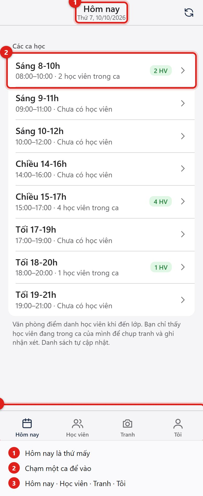

**Kết quả đúng**
- [ ] Ngày là ngày theo giờ Việt Nam; ca nào có học viên đã đến hiện số học viên; ca đang diễn ra có nhãn.

---

### T2 · Học viên trong ca

| Ai | Ứng dụng | Thời lượng |
|---|---|---|
| G | App giáo viên | 2 phút |

**Mục tiêu:** thấy ngay những học viên đang học trong ca của mình. **Điểm danh do văn phòng (Quản lý lớp học, Quản trị hệ thống) làm** khi học viên đến lớp (A5); giáo viên không tự điểm danh. Học viên không bắt buộc học cố định nên danh sách trong ca là những bạn **thực sự có mặt**, không phải danh sách đăng ký.

1. Màn **Hôm nay** cho thấy ca nào đã có học viên.

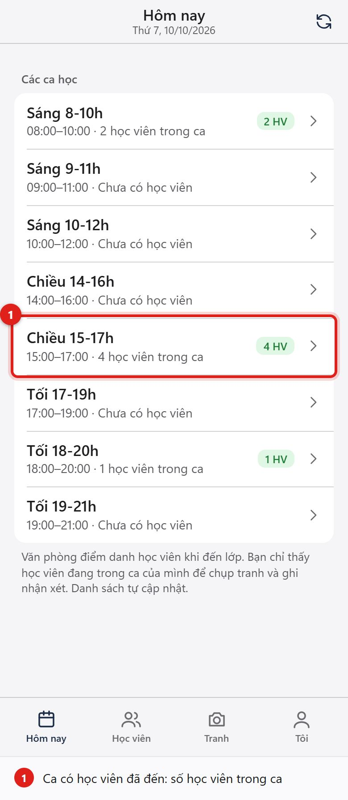

2. Chạm vào ca: chỉ hiện các bạn đang trong ca (đã được văn phòng điểm danh) kèm số buổi còn lại, nút **chụp tranh** và **nhận xét** cho từng bạn. Ca chưa có ai thì báo "Chưa có học viên trong ca" và tự cập nhật khi văn phòng điểm danh.

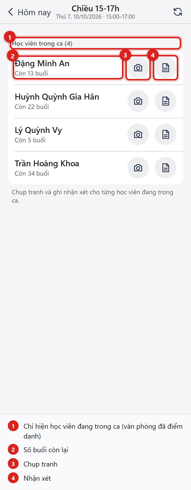

**Kết quả đúng**
- [ ] Giáo viên chỉ thấy các bạn đã được điểm danh vào ca **do mình dạy** (hoặc làm trợ giảng); không thấy danh sách đăng ký / thường đến, không thấy bạn ca khác.
- [ ] Giáo viên không có nút điểm danh; gọi API điểm danh bằng tài khoản giáo viên bị từ chối.
- [ ] Văn phòng điểm danh thêm bạn nào thì sau tối đa 30 giây (hoặc bấm làm mới) bạn đó hiện trong ca.

Nếu bị hỏi

- *Vì sao giáo viên không điểm danh?* Văn phòng điểm danh cho cả học viên và giáo viên cùng lúc, để số buổi, lương giáo viên và công nợ chỉ có một nguồn nhập. Giáo viên tập trung dạy, chụp tranh và nhận xét.
- *Mất mạng giữa chừng?* Ứng dụng báo lỗi kèm nút thử lại; **chưa có chế độ offline**.
- *Sửa nhầm điểm danh?* Văn phòng hủy/chuyển buổi (A6), mọi ngày đều được.

---

### T3 · Chụp tranh của học viên

| Ai | Ứng dụng | Thời lượng |
|---|---|---|
| G | App giáo viên | 3 phút |

**Mục tiêu:** chụp tranh ngay tại lớp, phụ huynh thấy trong vài giây.

1. Ở dòng học viên chạm biểu tượng **máy ảnh** → chụp (hoặc chọn ảnh có sẵn). Ảnh tự thu nhỏ trước khi gửi. Đặt tên tranh (không bắt buộc); công tắc **Cho phụ huynh xem** bật sẵn. Bấm **Lưu tranh**.

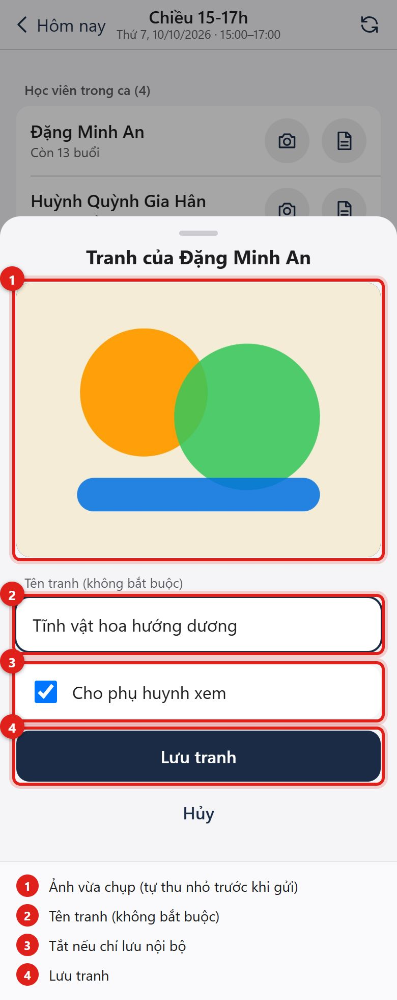

2. Thông báo đã lưu.

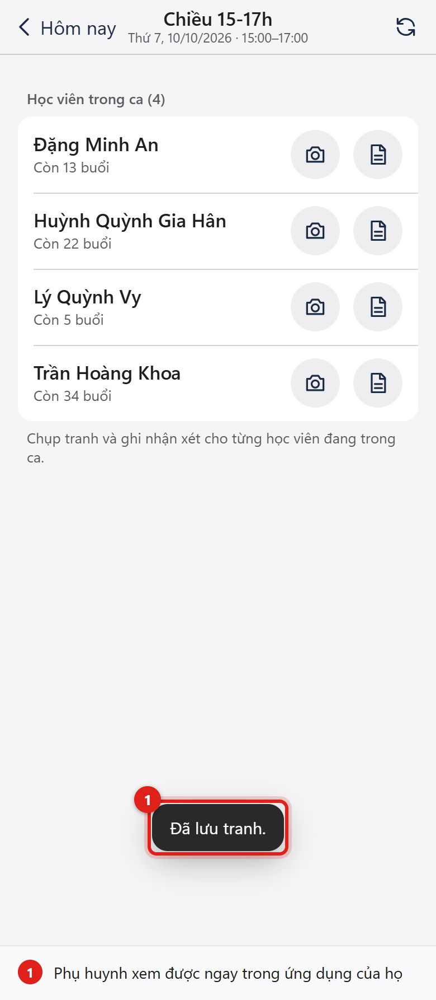

**Kết quả đúng**
- [ ] Ảnh nhỏ gọn (tối đa ~2000 px), có ảnh thu nhỏ để xem nhanh; ảnh lưu riêng tư, link xem chỉ có hiệu lực vài giờ.
- [ ] Tắt **Cho phụ huynh xem** thì ảnh chỉ nội bộ (giáo viên, văn phòng thấy; phụ huynh không).
- [ ] Giáo viên chỉ sửa/xóa ảnh do mình chụp.

Nếu bị hỏi

- *Ảnh lưu ở đâu?* Azure Blob Storage ở khu vực Đông Nam Á, truy cập qua đường dẫn ký tạm thời; không có ảnh công khai.
- *Ảnh trẻ em?* Quy định riêng của trung tâm (xin phép phụ huynh, không chụp mặt). Hệ thống cho phép đánh dấu từng ảnh là nội bộ.

---

### T4 · Nhận xét

| Ai | Ứng dụng | Thời lượng |
|---|---|---|
| G | App giáo viên | 2 phút |

1. Ở dòng học viên chạm biểu tượng **nhận xét** → viết vài câu → chọn có cho phụ huynh xem không → **Lưu nhận xét**.

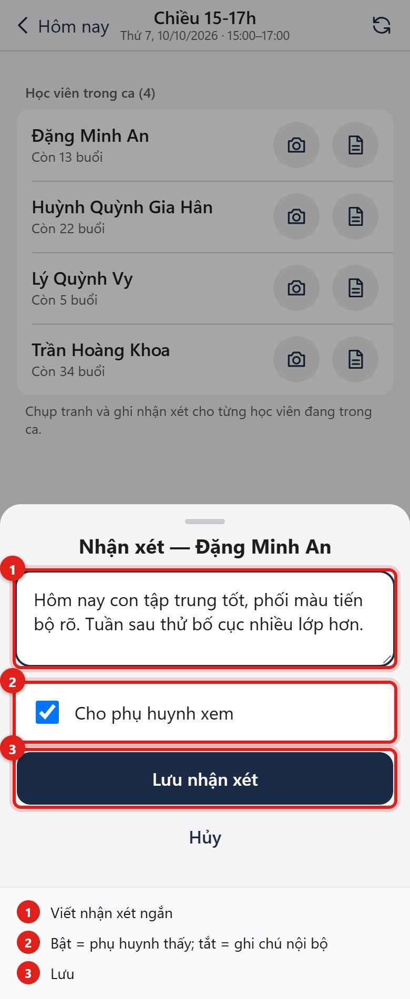

**Kết quả đúng**
- [ ] Nhận xét xuất hiện ở trang chủ phụ huynh (P1) và trong hồ sơ học viên (T5) ngay sau khi lưu.
- [ ] Nhận xét "nội bộ" chỉ nhân viên thấy.

---

### T5 · Hồ sơ học viên

| Ai | Ứng dụng | Thời lượng |
|---|---|---|
| G | App giáo viên | 2 phút |

1. Tab **Học viên**: tìm theo tên (không cần dấu).

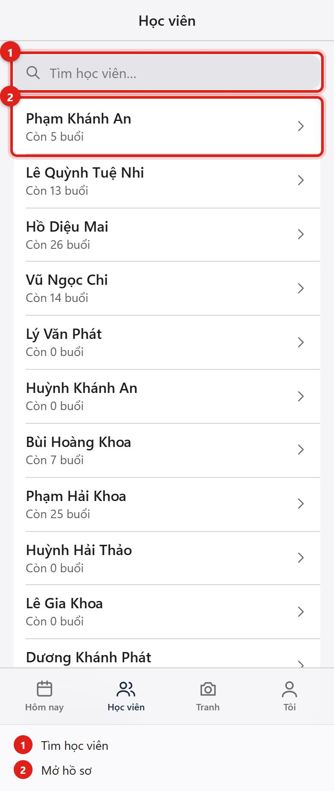

2. Hồ sơ: số buổi còn lại, nút chụp tranh / nhận xét nhanh, các khóa học, tranh gần đây, nhận xét.

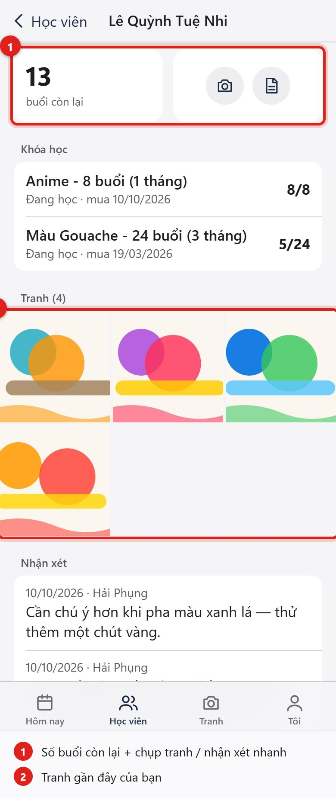

3. Chạm một tranh để xem lớn, lướt trái/phải.

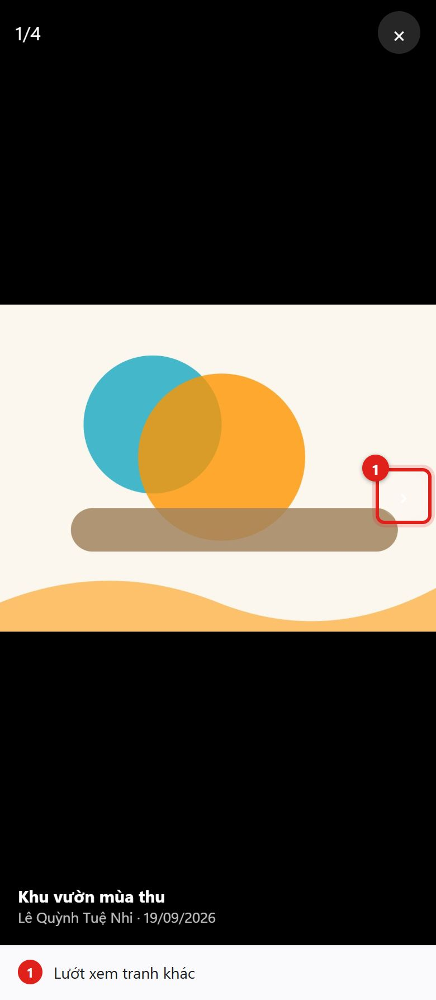

**Kết quả đúng**
- [ ] Giáo viên **không thấy** công nợ, số điện thoại, email và tên phụ huynh của học viên (kể cả khi gọi trực tiếp API).

---

### T6 · Tranh gần đây

1. Tab **Tranh**: tranh mới chụp của mọi học viên, chạm để xem.

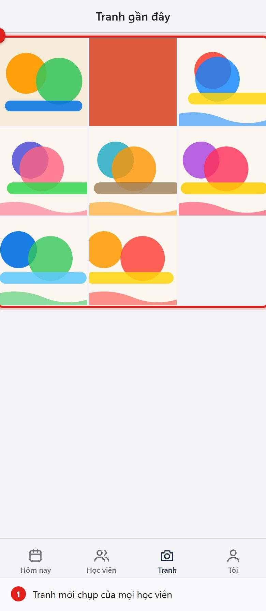
