# App phụ huynh / học viên

Ứng dụng web cài lên điện thoại (PWA): `…/parent/`. Dùng cho phụ huynh (PH) và học viên lớn tự đăng nhập. Ảnh chụp ngày 10/10/2026, khung điện thoại 390×844. **Ứng dụng chỉ đọc**: phụ huynh không sửa được dữ liệu nào.

| Mã | Case | Phút | Ai |
|---|---|---|---|
| [P0](#p0--vào-bằng-linkqr-của-trung-tâm) | Vào bằng link / mã QR của trung tâm | 2 | PH mới |
| [P1](#p1--trang-chủ) | Trang chủ: số buổi còn lại, tranh mới, lịch học, nhận xét; nhiều con | 3 | PH |
| [P2](#p2--thư-viện-tranh) | Thư viện tranh và xem tranh lớn | 2 | PH |
| [P3](#p3--học-tập) | Khóa học, các buổi đã học, nhận xét | 2 | PH |
| [P4](#p4--học-phí) | Học phí: còn nợ, các lần đăng ký | 2 | PH |
| [P5](#p5--thêm-con-vào-cùng-tài-khoản) | Thêm con vào cùng một tài khoản | 2 | PH |

Thứ tự trình bày: P0 → P1 → P2 → P3 → P4 → P5.

---

### P0 · Vào bằng link / mã QR của trung tâm

| Ai | Ứng dụng | Thời lượng |
|---|---|---|
| Ba của bé Lý Văn Phát | App phụ huynh | 2 phút |

**Mục tiêu:** phụ huynh vào đúng dữ liệu của con chỉ bằng link hoặc mã QR do trung tâm gửi: không đăng ký email, không mã xác nhận.

1. Khi đăng ký học viên, văn phòng đã tạo sẵn tài khoản phụ huynh và gửi link / mã QR (A15). Phụ huynh mở link (hoặc quét QR bằng camera) → vào thẳng trang chủ của con. Thiết bị đó nhớ đăng nhập (180 ngày, tự gia hạn khi dùng).
2. Cách cũ vẫn còn cho ai đã có tài khoản email: màn **Đăng nhập** có nút "đăng nhập bằng email"; lần đầu nhập **mã mời** (A12). Màn dưới là màn nhập mã mời.

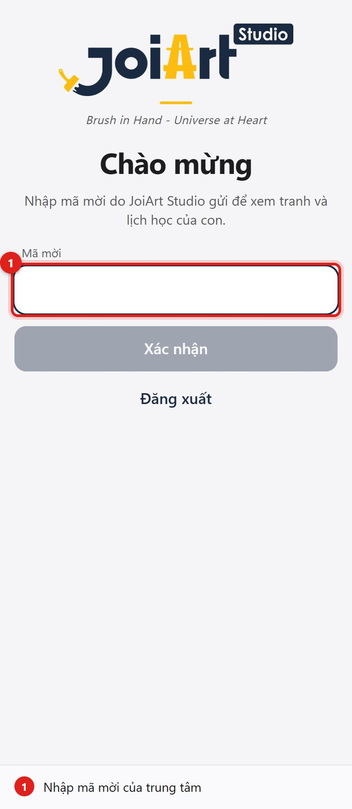

3. Vào thẳng trang chủ của con.

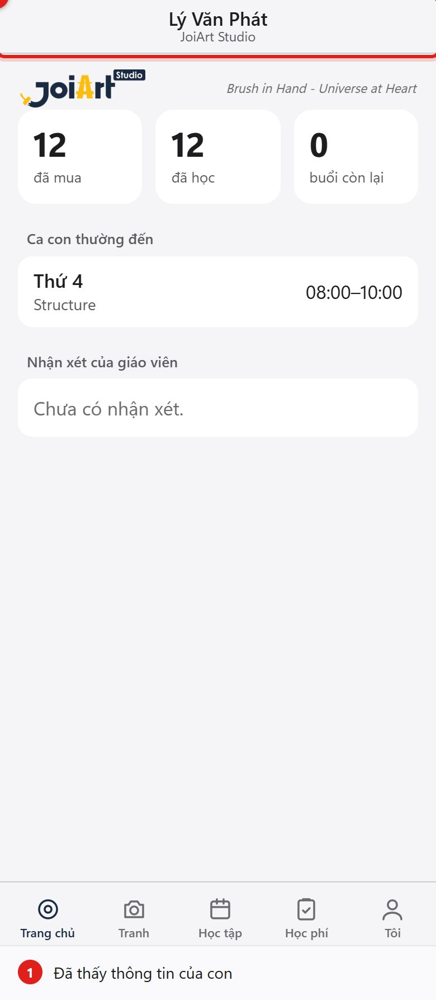

**Kết quả đúng**
- [ ] Link chỉ mở được dữ liệu của đúng học viên đã gắn; mất điện thoại thì văn phòng tạo lại link và đăng xuất thiết bị cũ (A15).
- [ ] Link bị xóa khỏi thanh địa chỉ sau khi mở; "Đăng xuất khỏi thiết bị này" ở tab Tôi chỉ đăng xuất thiết bị đó.
- [ ] Quan hệ (Mẹ, Ba, Ông…) do văn phòng khai khi tạo tài khoản.

---

### P1 · Trang chủ

| Ai | Ứng dụng | Thời lượng |
|---|---|---|
| Mẹ của bé Tuệ Nhi và bé Hoàng Khoa | App phụ huynh | 3 phút |

1. Trang chủ: ba con số **đã mua / đã học / buổi còn lại** (luôn khớp với sổ buổi học), số bức tranh, **tranh mới nhất**, **các buổi đã đăng ký sắp tới** (nếu có), **ca con thường đến** (chỉ để tham khảo, con có thể đến ca khác), nhận xét gần đây. Khi có nhiều con, thanh trên cùng cho chuyển giữa các con.

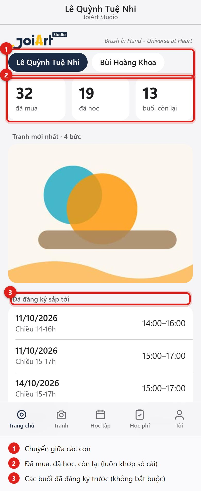

2. Bấm tên con thứ hai: toàn bộ ứng dụng chuyển sang con đó (nhớ lựa chọn cho lần sau).

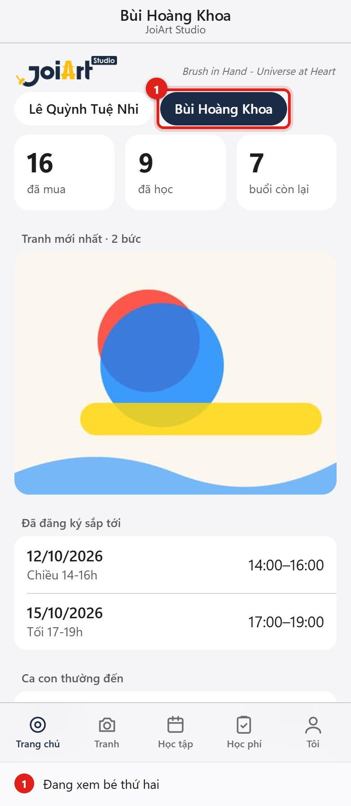

**Kết quả đúng**
- [ ] Còn 1–2 buổi: hiện nhắc **Con sắp hết buổi học**; còn nợ học phí: hiện thông báo đỏ.
- [ ] Chỉ thấy con của mình; không có cách nào xem học viên khác (máy chủ trả "không tìm thấy").

---

### P2 · Thư viện tranh

| Ai | Ứng dụng | Thời lượng |
|---|---|---|
| PH | App phụ huynh | 2 phút |

1. Tab **Tranh**: lưới ảnh nhỏ, mới nhất đứng đầu.

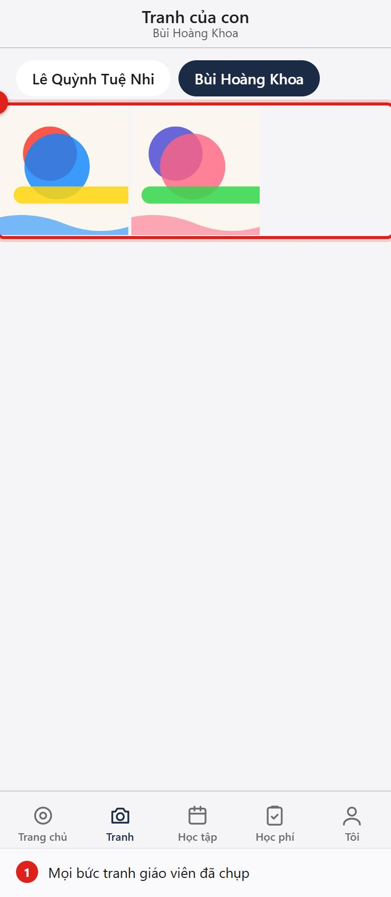

2. Chạm một bức để xem lớn: tên tranh, ngày vẽ, giáo viên; mũi tên lướt sang bức kế.

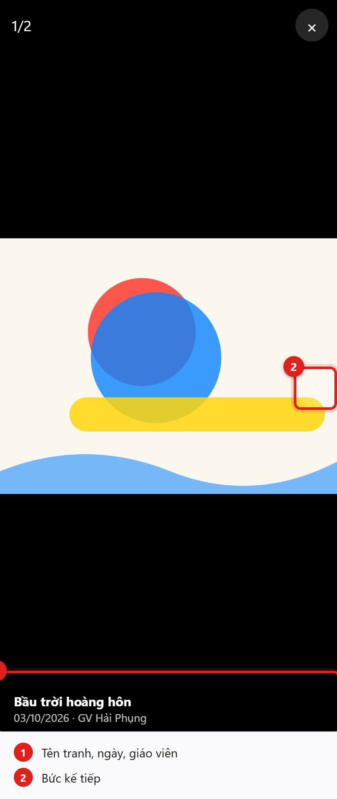

**Kết quả đúng**
- [ ] Ảnh giáo viên tắt "Cho phụ huynh xem" không xuất hiện.
- [ ] Ảnh vừa chụp ở lớp (T3) hiện ngay khi phụ huynh mở lại ứng dụng hoặc quay lại màn hình.

Nếu bị hỏi

- *Lưu ảnh về máy?* Bấm giữ ảnh khi xem lớn. (Chưa có nút tải/chia sẻ riêng — xem 90-su-co-gioi-han.md.)
- *Ai khác xem được ảnh?* Đường dẫn ảnh tạo riêng cho từng lần xem và hết hạn sau vài giờ; không có ảnh công khai.

---

### P3 · Học tập

| Ai | Ứng dụng | Thời lượng |
|---|---|---|
| PH | App phụ huynh | 2 phút |

1. Tab **Học tập**: khóa học (còn / tổng số buổi, trạng thái) và danh sách các buổi đã học gần đây: ngày, ca, giáo viên, khóa.

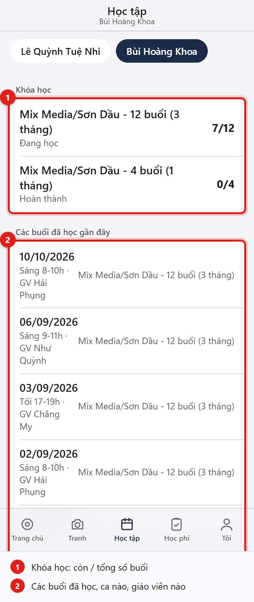

2. Kéo xuống: nhận xét của giáo viên (chỉ phần được chia sẻ).

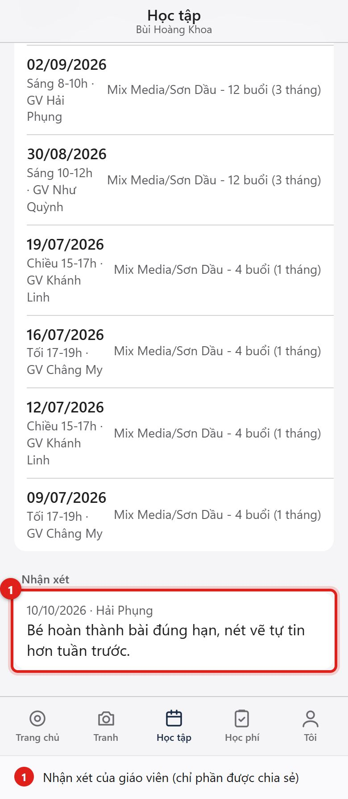

**Kết quả đúng**
- [ ] Buổi đã hủy (điểm danh nhầm) không hiện trong danh sách.

---

### P4 · Học phí

| Ai | Ứng dụng | Thời lượng |
|---|---|---|
| PH | App phụ huynh | 2 phút |

1. Tab **Học phí**: số **còn phải đóng** (hoặc đã đóng dư / không còn nợ) và từng lần đăng ký: nội dung, ngày, tổng, đã đóng, còn nợ.

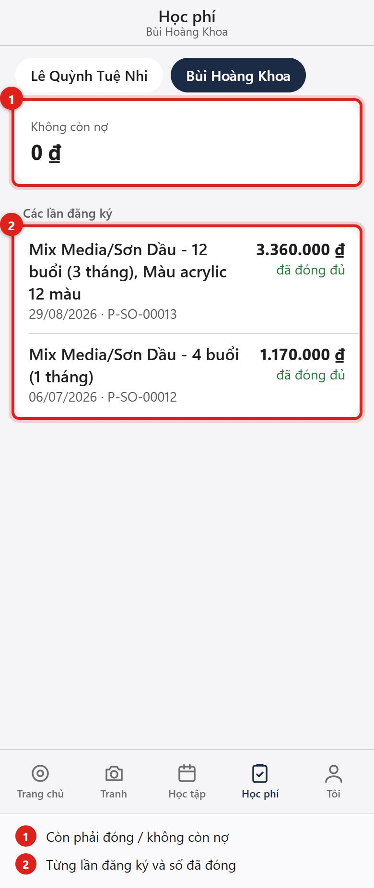

**Kết quả đúng**
- [ ] Số khớp với công nợ trong hồ sơ học viên ở back-office (A2 tab Công nợ).
- [ ] Đơn đã bị đảo ngược không hiện.

---

### P5 · Thêm con vào cùng tài khoản

| Ai | Ứng dụng | Thời lượng |
|---|---|---|
| PH | App phụ huynh | 2 phút |

**Mục tiêu:** con thứ hai/thứ ba đăng ký học sau vẫn dùng một tài khoản.

1. Văn phòng tạo một mã mời **Phụ huynh** mới cho bé đó. Phụ huynh mở tab **Tôi** → ô **Mã mời của con khác** → **Thêm con**.

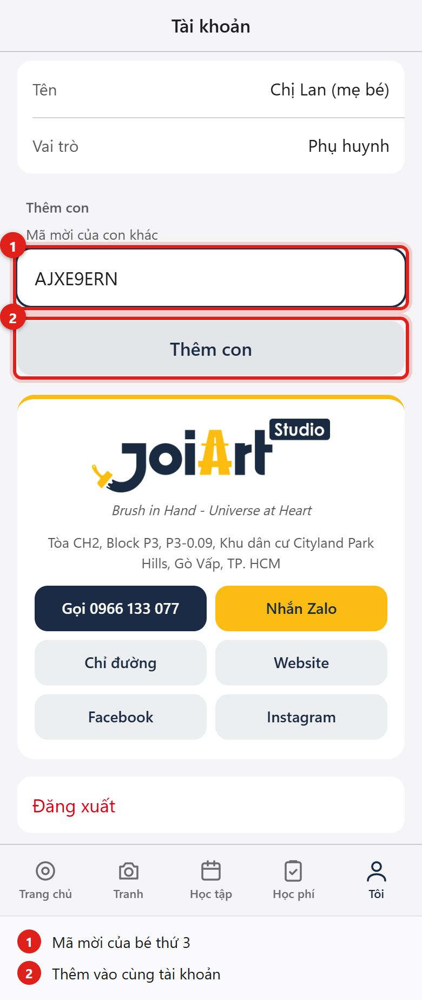

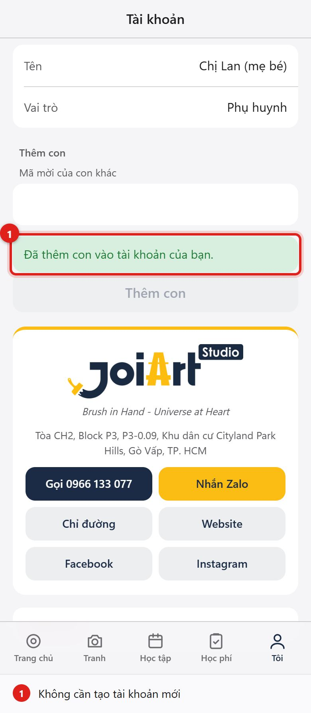

**Kết quả đúng**
- [ ] Không phải tạo tài khoản mới; thanh chuyển con ở trang chủ có thêm bé mới.
- [ ] Thêm lại cùng một bé bị từ chối; mã dùng một lần.
